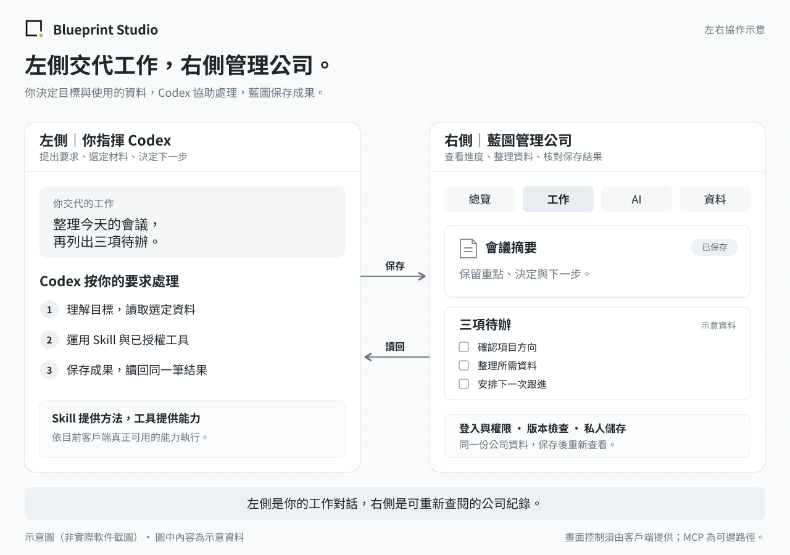

<p align="center">
  <a href="https://blueprint-agent-studio.onrender.com/">
    <picture>
      <source media="(prefers-color-scheme: dark)" srcset="assets/brand/mark-light.svg">
      
    </picture>
  </a>
</p>

<h1 align="center">Blueprint Studio Open Source</h1>

<p align="center"><strong>Direct Codex on the left. Manage your company in Blueprint on the right.</strong></p>

<p align="center"><a href="README.md">繁體中文</a> · <strong>English</strong></p>

<p align="center">
  <a href="docs/USER_GUIDE.md">User guide</a> ·
  <a href="#first-install">First installation</a> ·
  <a href="#keep-updated">Update your workspace</a> ·
  <a href="https://github.com/collieai-g/Blueprint-Studio-Open-Source/releases/latest">Download a release</a> ·
  <a href="https://blueprint-agent-studio.onrender.com/">Official website</a>
</p>

**Blueprint Studio is an open-source company workspace that works alongside Codex.** Give instructions on the left; let Codex organize material and carry out the work. On the right, Blueprint stores your company's documents, projects, tasks and results so you can review them and continue later.



*An illustration, not a software screenshot. Its Chinese labels show goals, Skills and authorized tools on the left; Overview, Work, AI and Data on the right. Your AI app or window arrangement provides the two panels. Blueprint does not embed Codex.*

## Complete one real task first

1. **Put both views together.** Open a conversation in your usual Codex app. Put your installed Blueprint workspace in its right browser panel, or in an adjacent window.
2. **Specify the work.** Upload or select the material in Blueprint, then tell Codex what you want to accomplish.
3. **Check the saved result.** Codex uses the actual operations available to it. Reopen the same record to check its text, tasks and attachments.

For example:

> Use the meeting notes I selected to summarize the decisions and create three tasks in this project. Save them, then reopen the same records so I can check them.

When the active client actually provides authorized control of the same signed-in workspace, Codex can click, fill forms and upload files without you writing API calls. MCP is another optional tool route. **Seeing a webpage, being able to control it and successfully saving a record are separate capabilities.** The Blueprint backend still handles sign-in, permissions, version checks and private storage.

If you have not installed the workspace, start with the [installation instruction](#first-install) below. Otherwise, follow the [user guide](docs/USER_GUIDE.md) or the detailed [side-by-side workflow](docs/LEFT_RIGHT_WORKFLOW.md). Detailed guides are primarily in Traditional Chinese.

## Four entries for daily company management

| Entry | What you review in Blueprint | What you can ask Codex to do |
| --- | --- | --- |
| **Overview** | Today's focus, recent results and a company work summary | “Organize the three most important things for today.” |
| **Work** | Projects, inbox, todos and daily work records | “Summarize progress and update this project's tasks.” |
| **AI** | Skills and handoff, compatible Agents, commands and connections | “Use this video Skill and the selected material to prepare production.” |
| **Data** | Files, bookmarks, topics and pinned records | “Group this report and its reference links under one topic.” |

The workspace uses white, light gray and a faint grid. Move, resize and collapse overview cards; layout preferences stay in the current browser. Secondary pages retain existing records, permissions and compatible links.

Idle time and returning to the window do not rebuild the screen. Workbench writes update their corresponding results; use **Update data** after an external tool saves new records.

[Daily use](docs/USER_GUIDE.md) · [Layout guide](docs/LAYOUT.md) · [Features and implementation status](docs/V2.4.md)

## Skills provide a method; tools do the production

For a personalized video, open **AI → Skill & handoff**, choose a video task, enter its goal, duration and style, and select brand material. Codex follows the Skill to prepare a script and storyboard, then uses the video or editing tools actually available to produce a result and save it to Blueprint.

A reusable `SKILL.md` contains professional workflow rules. A private brief contains the current requirements and selected references. Download them separately, or save the brief as a report using the same backend and source permissions. Reference IDs do not include the original attachments; the active client must retrieve those through an authorized route.

Downloading a Skill does not install a plugin or start Codex. Without video tools, deliver the script and storyboard and keep the finished video pending. A separate hosted AI service is not required for every video workflow.

[Video workflow](docs/USER_GUIDE.md) · [Reusable video Skill](templates/skills/personal-video/README.md)

## Daily saves do not require redeployment

Reports, tasks, bookmarks and existing settings save through the current interface or authorized tools. They do not require Git commits or website publication. Source changes, new button behavior, additional software capabilities and upgrades need testing and deployment.

The public repository contains reusable software and documentation. Keep company records, attachments, private preferences, credentials and complete backups in separate private storage. Ordinary chats are not automatically stored in full, and Blueprint does not read private conversations from other platforms.

The [operating model](docs/OPERATING_MODEL.md) explains company source versions, everyday records, Skills and optional Agents.

## Installation and updates

A local installation runs on your computer; a cloud installation provides a website you can sign in to. The AI verifies the latest stable release and reuses your platform choices. Native installation must verify a complete backup download, isolated restore, restart persistence and a supported update route.

<a id="first-install"></a>

### 1. First installation

Open a conversation with an AI that has installation or deployment tools, then copy this instruction.

<details>
<summary>Show the installation instruction</summary>

```text
Help me install Blueprint Studio Open Source for the first time. Guide me step by step in English.
Read and follow the current installation entry point:
https://github.com/collieai-g/Blueprint-Studio-Open-Source/blob/main/INSTALL_AI.txt

Verify the latest stable release and pin its tag and commit for this run. Check this AI app’s actual tools, then help me choose local or cloud installation; reuse any choices already made.
Complete the original interface, sign-in, persistent storage, a real AI write and readback, and a matching result in the workspace. Then help me complete one real task. When I need to act, give me the location, action and sign of success for the current step.
Keep private data and installation progress outside the public repository. Follow my selected goal: if I explicitly want a fresh installation while keeping the old site untouched, use a separate service and data location. Do not switch to updating the old site just because it exists, or make its backup a prerequisite for the independent installation. Use UPDATE_AI.txt only when I want to update the existing workspace while preserving its data.
```

</details>

To install alongside an old site, add: “Install a fresh native workspace and leave the old site untouched.” Use a separate service, data and backup location; do not import old records automatically.

<a id="keep-updated"></a>

### 2. Every later update

Give the following instruction to the AI managing your existing workspace. Keep the original URL, sign-in, records, attachments and customizations.

<details>
<summary>Show the update instruction</summary>

```text
Help me update my existing Blueprint Studio Open Source workspace to the latest stable release. Guide me in English.
Read and follow the current update entry point:
https://github.com/collieai-g/Blueprint-Studio-Open-Source/blob/main/UPDATE_AI.txt

Verify and pin the target tag and commit for this run. Keep the original URL, sign-in, records, attachments and customizations. Find existing private progress records and source checkpoints, then resume from them.
Verify a complete, restorable backup before integrating the release and deploying to the original service. Check the old records and updated interface, then verify that the current AI can write and read back the same record. Do not stop after saving source code or downloading a package.
Keep all private source, data, settings and backups outside the public repository. If a required capability is missing, name the specific gap and next action. Report website deployment and AI connection status separately.
```

</details>

A GitHub release does not update your installed workspace automatically. Complete backup, integration, deployment to the original service and verification. Resume from existing private progress and verified source when switching conversations.

If the AI cannot read GitHub, download the full `-installer.zip` package from the [latest stable release](https://github.com/collieai-g/Blueprint-Studio-Open-Source/releases/latest) and ask it to read the included entry point. A `-workbench.zip` contains only the interface, not a full backend.

[Installation guide](docs/INSTALL.md) · [Local installation](docs/INSTALL_LOCAL.md) · [Cloud installation](docs/INSTALL_CLOUD.md) · [Backups and updates](docs/NATIVE_LIFECYCLE.md)

## Clients, connections and development

The development version makes specialist presets opt-in and stops automatically queuing capture jobs when bookmarks are saved. Pages and forms load reference data on demand and reuse reads within an operation. The reusable [D1 storage module](docs/SITES_D1_STORAGE.md) separates read snapshots from writes; platform adapters must integrate it explicitly. Updating public source does not update private workspaces.

Codex and other compatible AI apps can only use the tools the active client actually provides. Browser control must reach the correct signed-in tab. Chat or preview alone can prepare instructions and files but cannot prove workbench operation. For MCP, use the [connection guide](docs/AI_CONNECTION.md) and [connection center](docs/CONNECT.md) to verify real writes and readback.

The project provides 40 shared MCP tools. Native and Sites-to-native deployments add two owner-only backup tools, for 42 in total. These tools are an optional integration route, not a prerequisite for browser-based operation.

A runnable Python backend is provided for local and cloud use, with Docker, Render and Railway guidance. A [Sites gateway with a native backend](docs/SITES_NATIVE_GATEWAY.md) is another route. A backend that stores data within Sites still needs its platform adaptation and proven backup/restore; there is no universal installation requiring no setup.

For pinned package versions, source digests and persistent job states, see the [Agent contract](docs/AGENT_CONTRACT.md), [template](templates/agent/README.md) and [independent summary demo](https://github.com/collieai-g/collieai-g-Blueprint-Agent-Summary). This protocol is not required for every Skill. Registration or a connected adapter does not mean a customer-service, video or background AI service is running.

<details>
<summary>Historical workspace screenshots</summary>


This is a historical V2.4 screenshot, not the current four-entry interface. [Historical mobile view](artifacts/studio-v2.4-mobile.png).

</details>

## Documentation and contributions

| You want to learn about | Read |
| --- | --- |
| Two panels and your first daily task | [User guide](docs/USER_GUIDE.md) |
| Collaboration, Skills and video work | [Side-by-side workflow](docs/LEFT_RIGHT_WORKFLOW.md) · [Operating model](docs/OPERATING_MODEL.md) |
| Installation and daily work | [Start here](START_HERE.md) · [Full installation guide](docs/INSTALL.md) · [Daily work](docs/DAILY_WORK.md) |
| Updates, backups and recovery | [Update route](docs/UPDATE_ROUTE.md) · [Upgrade guide](docs/UPGRADE.md) |
| Hosting and development | [Backend guide](docs/LIBRARY.md) · [Platform adaptation](docs/STUDIO_API.md) · [Agent roadmap](docs/AGENT_ROADMAP.md) · [Folder tools](docs/USAGE.md) |
| Releases and verification | [Stable releases](https://github.com/collieai-g/Blueprint-Studio-Open-Source/releases/latest) · [Changelog](CHANGELOG.md) · [Validation records](VALIDATION.md) |

**About Blueprint Studio** — Let AI help with the work and keep company records organized. The [official website](https://blueprint-agent-studio.onrender.com/) introduces the brand and custom services.

The README is available in Traditional Chinese and English. Detailed guides and the workspace interface are primarily in Traditional Chinese. Released under the [MIT License](LICENSE). Questions and improvements are welcome through [Issues](https://github.com/collieai-g/Blueprint-Studio-Open-Source/issues) or Pull Requests. Use test data when sharing examples.
