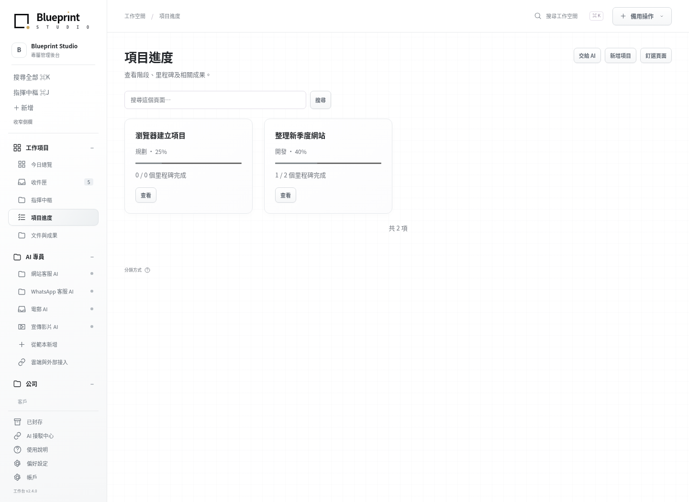

<p align="center">
  <a href="https://blueprint-agent-studio.onrender.com/">
    <picture>
      <source media="(prefers-color-scheme: dark)" srcset="assets/brand/mark-light.svg">
      
    </picture>
  </a>
</p>

<h1 align="center">Blueprint Studio Open Source</h1>

<p align="center"><strong>Codex advances the work. Blueprint manages the company. Independent Agents provide specialist capabilities.</strong></p>

<p align="center">
  <a href="README.md">繁體中文</a> · <strong>English</strong>
</p>

<p align="center">
  <a href="https://blueprint-agent-studio.onrender.com/">Official website</a> ·
  <a href="https://github.com/collieai-g/Blueprint-Studio-Open-Source/releases/latest">Download the latest release</a> ·
  <a href="#first-install">First installation</a> ·
  <a href="#keep-updated">Update your workspace</a>
</p>

Blueprint Studio is an open-source shared workspace connecting AI tools such as Codex, company information and independent Agents. Keep your main conversation in Codex; use Blueprint to manage company records, Agent settings, progress and results. Authorized AI tools and interface controls read and write the same private backend data.

Blueprint provides shared management and connection capabilities. It does not bundle working business Agents such as customer service. Developers maintain specialist Agents in separate repositories and connect them through the shared contract; the template and independent summary demo support development and acceptance checks.

In AI apps that support a split view, chat on the left and view your workspace on the right. You can also open it in a separate browser tab. **AI understands and organizes the work. The workspace stores it and makes it visible.**

A [Sites gateway with a native backend](docs/SITES_NATIVE_GATEWAY.md) keeps company data and backups independently manageable while retaining the original UI and MCP entrypoint. Live hosting and platform acceptance remain installation work. **2.6 adds a [shared workbench for independent Agents](docs/AGENT_ROADMAP.md)**: each Agent keeps its own repository and pinned version, while Studio manages settings, prepared jobs and results. The active Codex or compatible AI conversation performs the work. No autonomous customer-service or background AI executor is included.

## How it works: daily records and software updates

For a fictional company, “123 Medical Studio,” ask Codex to summarize today's research progress, save a report and update the tasks. Codex reads authorized material, saves through tools and reads back the result; the workspace displays the same records. **Daily operations do not require GitHub changes or a Sites redeployment.**

| What you want to do | GitHub and deployment |
| --- | --- |
| Add daily work, update tasks, save documents or bookmarks, compile company reports, manage records | Save through existing APIs to the private backend; no source change or redeployment |
| Change existing company or Agent settings, or use built-in layout controls | Save settings directly; browser layout stays in that browser; no redeployment |
| Add an Agent compatible with the deployed contract | Review its pinned version, register it, configure it and enable its adapter; normally no company source change or redeployment |
| Change interface code or button logic, add unsupported AI capabilities, or upgrade Blueprint | Update the company's software version, test and deploy the affected services |

For long-term company-specific development, create or reuse your own **private GitHub source repository** for the company version and custom changes. When Blueprint releases an update, Codex integrates a selected version, preserves customizations, tests, backs up and updates the existing service. An upstream release does not automatically synchronize private repositories, and a GitHub push does not deploy Sites. Users of the unmodified original do not need a separate repository.

With a Sites entrypoint and independent backend, the backend supplies the interface and business functions. Compatible changes may require only a backend deployment; gateway or tool-contract changes also require publishing the existing Sites entrypoint. Customer service that continuously receives and answers messages needs a separately implemented runtime and channel connection.

[Full operating model: company repositories, independent Agents and deployment](docs/OPERATING_MODEL.md)

## Two instructions: install once, update whenever needed

**V2.5 prepares for the next update during installation.** The native local/cloud backend creates complete backups and rehearses restoration and migration before first startup or changed code. It also backs up periodically while running. Owners can download a private ZIP containing the database, login settings and original attachments from the update assistant. Installation includes a real download and authenticated restore check, restart persistence, and a supported redeployment route. [Lifecycle guide and limits](docs/NATIVE_LIFECYCLE.md).

**Yes—two fixed entry points can cover your first installation and repeated updates.** The instructions below do not name a specific version. Each time, the AI checks the latest stable release and pins the version for that run. You do not need a new prompt for every release.

The AI carries out the steps its tools support. When you need to sign in, grant access or approve a cost, it guides you through the next action. How much it can do depends on the tools available in your AI app. The detailed guides are there for the AI to follow.

<a id="first-install"></a>

### 1. First installation

Open a conversation with an AI that has installation or deployment tools, then copy this entire block:

```text
Help me install Blueprint Studio Open Source for the first time. Guide me step by step in English.
Read and follow the current installation entry point:
https://github.com/collieai-g/Blueprint-Studio-Open-Source/blob/main/INSTALL_AI.txt

Verify the latest stable release and pin its tag and commit for this run. Check this AI app’s actual tools, then help me choose local or cloud installation; reuse any choices already made.
Complete the original interface, sign-in, persistent storage, a real AI write and readback, and a matching result in the workspace. Then help me complete one real task. When I need to act, give me the location, action and sign of success for the current step.
Keep private data and installation progress outside the public repository. Follow my selected goal: if I explicitly want a fresh installation while keeping the old site untouched, use a separate service and data location. Do not switch to updating the old site just because it exists, or make its backup a prerequisite for the independent installation. Use UPDATE_AI.txt only when I want to update the existing workspace while preserving its data.
```

A local installation runs on your own computer. A cloud installation gives you a website you can sign in to. The AI reuses your existing accounts and resources, then helps with any setup still needed.

If you want a separate installation alongside an old site, add: “Install a fresh native workspace and leave the old site untouched.” The AI uses separate data and a new service. Old records stay on the old site and are not imported automatically. The new installation must still pass its own backup, restore and AI connection checks.

<a id="keep-updated"></a>

### 2. Every later update

Paste this entire block into the AI conversation that manages your existing workspace. **Reuse it for every new release.**

```text
Help me update my existing Blueprint Studio Open Source workspace to the latest stable release. Guide me in English.
Read and follow the current update entry point:
https://github.com/collieai-g/Blueprint-Studio-Open-Source/blob/main/UPDATE_AI.txt

Verify and pin the target tag and commit for this run. Keep the original URL, sign-in, records, attachments and customizations. Find existing private progress records and source checkpoints, then resume from them.
Verify a complete, restorable backup before integrating the release and deploying to the original service. Check the old records and updated interface, then verify that the current AI can write and read back the same record. Do not stop after saving source code or downloading a package.
Keep all private source, data, settings and backups outside the public repository. If a required capability is missing, name the specific gap and next action. Report website deployment and AI connection status separately.
```

Updating code on GitHub does not automatically update your installed workspace. The second instruction takes the AI through deployment and verification of the original service. If you already have the latest stable release, check the version and operation without reinstalling. If you switch conversations midway, keep the same target and completed progress.

If the AI cannot read GitHub, download the full package ending in `-installer.zip` from the [latest stable release](https://github.com/collieai-g/Blueprint-Studio-Open-Source/releases/latest). Give it to the AI to read the included `INSTALL_AI.txt` or `UPDATE_AI.txt`. If it cannot reach a required current guide, it should state that limitation. The `-workbench.zip` package contains the interface only, not a complete backend.

## See your company’s daily work in one place



*The original workspace’s project view, using test data. The interface currently uses Traditional Chinese. [View the mobile interface](artifacts/studio-v2.4-mobile.png).*

| Area | What it helps you do |
| --- | --- |
| **Work** | See today’s priorities, inbox, tasks and project progress. Keep documents and completed work together. |
| **AI specialists** | Keep existing specialist settings and use the Agent workbench to register pinned packages, change settings, prepare jobs for the active AI conversation and inspect results. |
| **Company** | Organize leads, quotes, contracts, invoices, payments, costs, team permissions and partners. |
| **Inspiration** | Save websites, YouTube links, reference images and learning notes, and link them to relevant work. |
| **Custom topics** | View related projects, documents and saved references together without duplicating the original records. |

White and light gray keep the view clear, with a faint grid to help align the layout. On the overview, move, resize and collapse cards along the grid. Headings, descriptions and dates use movable text without visible card borders. Add space below when needed, up to three pages. Search, uploads and task checkboxes remain available.

[Full feature list and implementation status](docs/V2.4.md) · [Personalize your layout](docs/LAYOUT.md)

## Describe the work. Let AI help organize it.

Once connected, you can ask your AI:

> Turn the work we just agreed on into three tasks and add them to this project.

> Save this reference link to Inspiration and connect it to the website redesign project.

> Wrap up today’s work: save the results, decisions and unfinished tasks to the company workspace.

The AI organizes the content it can see or that you provide, saves it through authorized tools, and reads it back to check. The workspace shows the same records. Ordinary conversation is not automatically stored in full, and the AI does not gain access to private chats on other platforms.

The built-in **AI connection center** guides you through sign-in, tool loading, a real write and a readback. An open webpage, an installed plugin and a conversation that can actually save data are separate states. The connection center checks real test results.

Wrapping up your day updates work records. To update the software, use the second instruction above.

## Which AI apps can I use?

The project started with ChatGPT and Codex workflows, but its connection method is not tied to one model. Installation and daily use depend on **the app running the model and the tools it makes available**.

| App or setup | What it needs |
| --- | --- |
| **ChatGPT / Codex** | Code execution or deployment tools for installation, and loaded, authorized Blueprint tools for daily writes. A built-in Sites route also requires a backend adapted to that platform. |
| **Claude, Gemini and others** | Connection guidance is provided for compatible MCP clients such as Claude Code and Gemini CLI. Whether a product can install the workspace also depends on its execution and deployment tools. |
| **Grok and other AI apps** | An app with compatible tool connections and the required installation capabilities can follow the same process. Not every product has been individually verified. |
| **Chat or webpage preview only** | These can explain steps or display a page. A complete workspace also needs a running backend, sign-in, and lasting storage for records and attachments. |

MCP is a shared way for AI apps to call workspace tools. This project provides 40 shared MCP tools, including 10 Agent tools. The native backend adds two owner-only backup tools, for 42 in total. Compatible clients can use the same authorized backend. **A Sites-like feature is a possible deployment route; a complete installation still needs backend execution, storage, sign-in and tool connections.** You can also host the backend elsewhere and connect your AI to it.

A runnable Python backend is provided for local and cloud use, with deployment guidance for Docker, Render and Railway. For Sites, the project provides the original interface, tool contracts and backend adaptation specifications; there is no universal one-click full installation yet. External services such as automatic specialist replies, webpage capture and video processing also need to be connected separately. Downloading the interface does not start those services.

[AI connection guide](docs/AI_CONNECTION.md) · [Local installation](docs/INSTALL_LOCAL.md) · [Cloud installation](docs/INSTALL_CLOUD.md)

## Manage independent Agents in one workbench

Each Agent lives in its own GitHub repository and follows the [shared contract](docs/AGENT_CONTRACT.md) for rules, settings, operations and a standard UI description. Studio renders common controls; its buttons and Codex MCP tools use the same backend data.

Settings save directly. An operation needing AI first creates a job; tell Codex to process its job ID. Codex reads the selected sources, performs the work and saves a result that appears in Studio. A repository URL does not install code, and connecting an adapter does not prove the active chat has loaded tools. Buttons do not wake Codex automatically.

When the installed workspace supports an Agent's contract, registration lets the existing interface display its operations without republishing Sites. Adding Agent files to the company repository does not automatically register or execute them; integrate and deploy code only when additional software capabilities are needed. Agent and Blueprint updates are selected separately, and existing jobs keep their original settings snapshots.

Start a new package from the [Agent template](templates/agent/README.md), or connect the separately published [summary demo Agent](https://github.com/collieai-g/collieai-g-Blueprint-Agent-Summary). Validate the complete handoff with a summary of explicitly selected material before using it for daily work. Company data and results stay in the existing backend; Agent packages keep independent versions.

## Keep company information in your own workspace

This public repository contains reusable software and documentation. Company records, attachments, credentials, chats, private workspace source and backups belong in separate private storage.

Each update keeps the original workspace: back up, integrate, deploy and verify. If private candidate source must survive a change of conversation, save it to a separately verified private repository. Keep source checkpoints separate from complete data backups. The [full update route](docs/UPDATE_ROUTE.md) covers source recovery through a working deployment.

## Documentation and contributions

| You want to learn about | Read |
| --- | --- |
| Daily operations, company versions and independent Agents | [Operating model](docs/OPERATING_MODEL.md) |
| Installation and first use | [Start here](START_HERE.md) · [Full installation guide](docs/INSTALL.md) |
| AI connections and daily work | [Connection center](docs/CONNECT.md) · [Daily work](docs/DAILY_WORK.md) |
| Updates, backups and recovery | [Update route](docs/UPDATE_ROUTE.md) · [Upgrade guide](docs/UPGRADE.md) |
| Hosting and development | [Backend guide](docs/LIBRARY.md) · [Platform adaptation](docs/STUDIO_API.md) · [Folder tools](docs/USAGE.md) |
| Releases and verification | [Stable releases](https://github.com/collieai-g/Blueprint-Studio-Open-Source/releases/latest) · [Changelog](CHANGELOG.md) · [Validation records](VALIDATION.md) |

**About Blueprint Studio** — Bringing AI into practical work, starting with a company’s daily needs. This open-source project provides a company workspace you can install and extend. The [official website](https://blueprint-agent-studio.onrender.com/) introduces the brand and its custom services. This README uses the official brand mark.

The README is available in Traditional Chinese and English. Detailed guides and the workspace interface are currently primarily in Traditional Chinese.

Released under the [MIT License](LICENSE). Questions and improvements are welcome through [Issues](https://github.com/collieai-g/Blueprint-Studio-Open-Source/issues) or Pull Requests. Please use test data when sharing examples.
