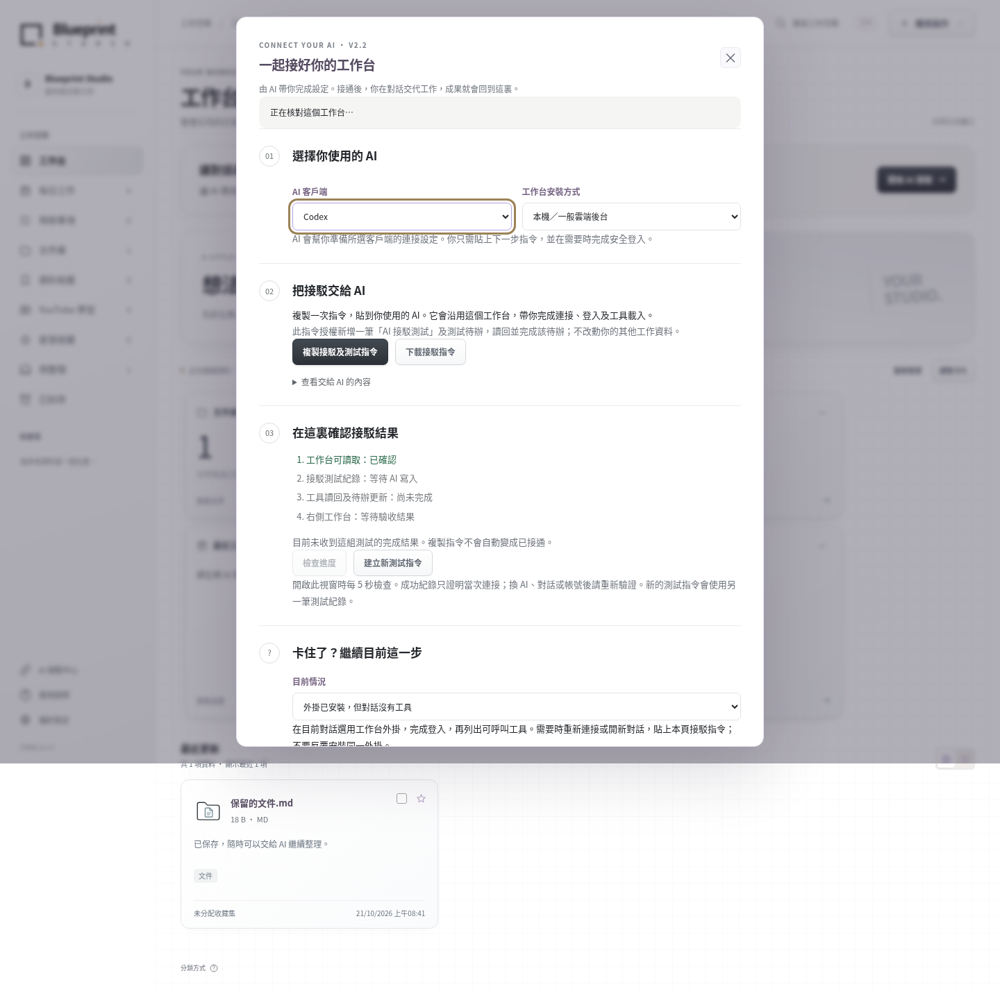
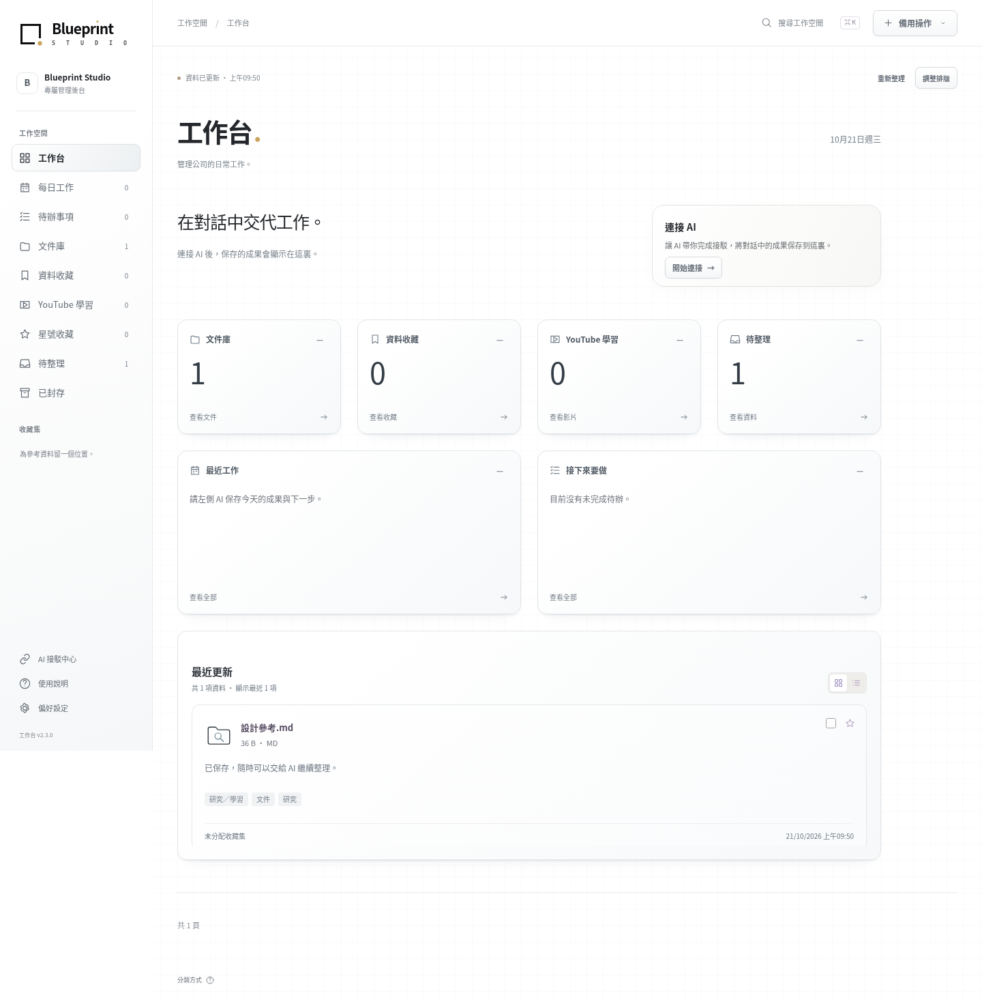

# Blueprint Studio Open Source

**藍圖工作室開源｜你公司的專屬後台。**

為管理公司大小事務而設，把每天的工作持續整理成公司的記憶。
說一句「今日收工」，由你接入的 AI 整合成果、決定、參考與待辦，留下有用內容，逐步累積及修整。
目前已提供公司設定、文件整理、資料收藏及每日工作；其他功能可按需要擴充。

[下載 V2.4.2 完整安裝包](https://github.com/collieai-g/Blueprint-Studio-Open-Source/releases/download/v2.4.2/blueprint-studio-v2.4.2-installer.zip) · [最簡單的 AI 安裝入口](START_HERE.md) · [安裝指引](docs/INSTALL.md) · [更新紀錄](CHANGELOG.md)

V2.4 新增五組側欄：工作項目、AI 專員、公司、靈感庫、自訂主題。原生版提供收件匣、指令、項目、客戶報價至發票、角色權限及主題關聯。[逐項功能與尚未接入部分](docs/V2.4.md)。專員依規格為設定空殼，外部自動化與 Sites 後台適配不會因下載 UI 包而自動完成。


以上為測試資料。[V2.4 手機導覽](artifacts/studio-v2.4-mobile.png)。

## 已安裝舊版本？升級到 V2.4

**[複製更新助手指令](UPDATE_AI.txt)**，貼到你現有工作台的 AI 對話。
2.4.2 修正換環境後候選程式無法取得的問題：新增獨立私人倉庫的來源檢查點，保存後重新下載核對。公開倉庫保持乾淨，任何私人來源、資料或接續包都不能存入。原更新助手、排版備份及環境／工具檢查繼續保留。[使用方式與實際範圍](docs/UPDATE_ASSISTANT.md)。
AI 先備份，再更新同一個網站／本機服務，保留公司資料、附件、登入、待辦及歷史。
Sites 有獨立的介面更新包及接駁步驟；不需要重新建立工作台。

V2.4 已內置 AI 接駁中心、30 個通用 MCP 工具、每個新對話的工作規則及真實讀寫驗收，供 Codex、Claude、Gemini 及其他相容客戶端連接同一個後台。
V2.4 保留白色淡格線與原版公司 logo。標題、說明、日期都是可移動的無框文字；文件庫等卡片也可沿同一套方格移動和調整大小。平時只顯示內容，按「調整排版」才顯示工具。底部可增加版面，最多三頁。[查看排版說明](docs/LAYOUT.md)。
預設由已連接 AI 填入工作內容，工作台自動同步；搜尋、上載、勾選待辦及手動備用操作仍然保留。
[不同 AI 的 MCP 接駁](docs/AI_CONNECTION.md) · [AI 工作方式](docs/AI_WORKSPACE.md) · [升級與回復](docs/UPGRADE.md)

工作台內置 [AI 接駁中心](docs/CONNECT.md)，會帶你處理授權、工具載入及網絡卡點，按實際讀寫結果顯示進度，再完成第一項工作。



以上為本機測試資料；正式工作台會顯示你的實際網址及測試結果。

## 貼給你的 AI，開始安裝

適用於具備專案、終端機或部署工具權限的 AI Agent，例如 Codex、Claude Code、Gemini CLI。
一般聊天 AI 亦可按同一份指引，帶你逐步操作。

```text
請幫我安裝或升級到 Blueprint Studio Open Source V2.4（2.4.2），建立並接通我自己的完整原版藍圖工作台。
公開工具：
https://github.com/collieai-g/Blueprint-Studio-Open-Source

先讀 START_HERE.md、docs/INSTALL.md、docs/CONNECT.md 及 AGENTS.md；已有工作台先讀 UPDATE_AI.txt 及 docs/UPDATE_ASSISTANT.md，用更新助手保存來源及接續進度，再按 docs/UPGRADE.md 備份並升級同一服務。檢查現有安裝和工具權限，保留已有資料、工作室及工具修改。先讓我選本機或雲端，已有選擇就沿用；再問工作室／公司名稱，行業、簡介及目標可以留空。每次帶我完成目前一步，不要只交付計劃就停止。

本機：跟 docs/INSTALL_LOCAL.md，在我自己的電腦檢查 Python、下載完整程式、準備私人資料與管理員，使用 library 指令啟動原版介面，完成登入及重啟保存驗證。辨認遠端 Codex 與我的電腦，不能把遠端 localhost 當成本機入口。

雲端：跟 docs/INSTALL_CLOUD.md，協助沿用或註冊所需帳戶；直接部署原版可沿用公開來源，需要私人修改時準備完整的私人 GitHub 倉庫，使用 Codex 雲端時協助授權及接入環境。需要我登入、驗證或按 Publish 時，給我確切下一步。環境 Publish／Republish 後繼續正式網站部署，直到有 HTTPS 工作台及持久儲存。按我的選擇使用 Render、Railway、自己的主機或 Sites。Sites 目前需要實際後台適配，公開倉庫未提供一鍵 Sites 部署；不能把 Python Docker 當作可直接部署到 Sites。

完整沿用 library_web/ 和 assets/icons/ 的原版介面、導覽及所有既有功能，不要另生成排版、簡化功能或用臨時示範代替。平台適配以後台、登入和儲存為主。依 docs/INSTALL.md 及 docs/LAYOUT.md 驗收原版功能、無框文字排版及最多三頁的方格版面，保存一筆工作及待辦並重啟後查回，再交付真實網址、資料位置和下次開啟方法；未驗證部分明確標示。

公開倉庫只保存通用程式，不得寫入私人來源、聊天、資料、設定或接續包。公司資料及安裝計劃放到程式專案以外的私人位置，由你維護 INSTALL_PROGRESS.md，換對話也能接續。setup 只產生計劃，已有公司資料不可重設。有工具就完成已授權的工作；普通聊天沒有工具時提供當前一步操作及有效公司 JSON 交接。涉及未授權收費先核對費用；密碼和金鑰只在平台秘密設定或本機安全輸入，不貼聊天。

工作台可用後，按 docs/AI_CONNECTION.md 安裝及接通所用 AI 的 MCP 工具，不限 Codex，亦支援 Claude、Gemini 及其他相容客戶端。原生版使用 mcp／mcp-config；Sites 使用同一網站的已驗證外掛。分別檢查安裝、授權、目前對話工具載入、真實寫入及讀回，不能把右側網頁打開當成 AI 已接通。開啟工作台內置『AI 接駁中心』，選擇實際客戶端及安裝方式，使用它產生的接駁指令。每個新對話先讀 blueprint_connection_guide 的內置工作規則；將後台地址及規則合併到客戶端支援的私人指引，保留原設定。我授權建立一筆明確標示的接駁測試及測試待辦。透過已載入的 blueprint_verify_connection 完成保存、讀回及待辦更新，讓右側接駁中心讀到同一筆驗收結果。網絡受阻、工具未載入或登入失敗時，按內置卡點指引帶我逐步處理，不繞過平台權限。最後帶我完成第一項真實文件、收藏或工作任務；回報保存 ID、讀回及右側顯示結果。未完成不能只交付網站就停止。以後我說『今日收工』，請整理目前可見或我提供的對話，只保存有用成果、已確認決定、參考及未完成待辦，去重及精煉，沿用來源識別；修改使用版本檢查並保留可恢復歷史，不用隨機識別繞過衝突。不保存秘密或整段原始聊天，不聲稱能讀取其他平台不可見對話。目前沒有可用連線時，只輸出可匯入 JSON，不聲稱已儲存。按 docs/V2.4.md 驗收五組側欄與公司資料流程。原生版以完整備份升至 schema 5，回復舊版須匹配舊資料快照。Sites 先按 docs/STUDIO_API.md 在原後台完成適配，單換 UI 不能完成升級。專員及外部截圖／影片服務未接入時保留等待狀態，不宣稱已自動執行。
```

## 兩條完整安裝路線

先選本機或雲端，再由 AI 逐步帶到原版工作台可用。已有帳戶、環境或網站會接續使用。

| 模式 | 逐步指南 | 安裝結果 |
| --- | --- | --- |
| **本機** | [Windows／macOS／Linux](docs/INSTALL_LOCAL.md)：Python → 完整程式 → 私人資料及登入 → 原版介面 → AI | 在自己的電腦啟動及使用，資料保存在私人目錄 |
| **雲端** | [GitHub／Codex／正式部署](docs/INSTALL_CLOUD.md)：帳戶與程式 → Codex 接入 → 部署選擇 → 原版介面及永久儲存 → AI | 可以登入的 HTTPS 工作台，按需要在 ChatGPT 右側開啟 |

雲端指南包含 Render、Railway、自己的主機及 Sites。原生平台已有部署設定；Sites 需完成後台適配，目前沒有現成的一鍵 Sites 安裝版本。所有路線保留原版介面及全部既有功能。

[安裝總覽與完整驗收](docs/INSTALL.md)亦包含中途換對話的接續方法。公司私人資料獨立保存，正式主機費用以所選平台確認為準。

## 每日一句「今日收工」

接好後，對正在使用的 AI 說：

> 今日收工，幫我整合今日工作，更新公司後台。

AI 會保留有用成果、重要決定、設計／學習參考及下一步；參考網址加入收藏，待辦可以勾選完成。
同一份工作可以合併新內容、修整或移除雜訊，修改歷史及完成進度保留。

AI 整理目前可見或你明確提供的對話；工具不會自行讀取各平台未提供的聊天。
沒有工具權限的 AI 可輸出整理結果，貼回後台預覽、修改及保存。

[每日工作與 AI 連接說明](docs/DAILY_WORK.md)

## 目前可以做甚麼？

- **公司設定**：名稱、行業、簡介與目標，保存在自己的後台。
- **文件整理**：保存原檔、分類、標籤及統一線條圖示。
- **資料收藏**：保存網站、UI 參考、YouTube 與學習筆記。
- **工作管理**：每日紀錄、版本歷史、待辦、星號及快捷搜尋。



以上使用示範資料。[V2.3 排版的手機介面](artifacts/layout-v2.3-mobile.png)。公司設定、每日工作及歷史操作完整保留。
分類目前使用本機規則；收藏網址未有自動讀取網頁全文或影片字幕。

## 更新工具

依[升級指南](docs/UPGRADE.md)先備份，再整合新版程式、重新啟動原服務／部署同一網站，最後驗證原資料。
更新 GitHub 不會自動改動你已安裝的私人工作台。以後每個版本都可沿用這個流程，保留原本資料及自訂內容。「今日收工」更新的是工作資料。

舊版文件夾與離線資料包工具保留，見[詳細用法](docs/USAGE.md)。
後台儲存、備份及自行部署見[公司後台說明](docs/LIBRARY.md)。

## 開源與參與

目前版本 **2.4.2**。程式碼、文件及自製圖示採用 [MIT 授權](LICENSE)，可以使用、修改及分享。
歡迎提交 [Issues](https://github.com/collieai-g/Blueprint-Studio-Open-Source/issues) 或 Pull Request。
[更新紀錄](CHANGELOG.md) · [驗證紀錄](VALIDATION.md)
