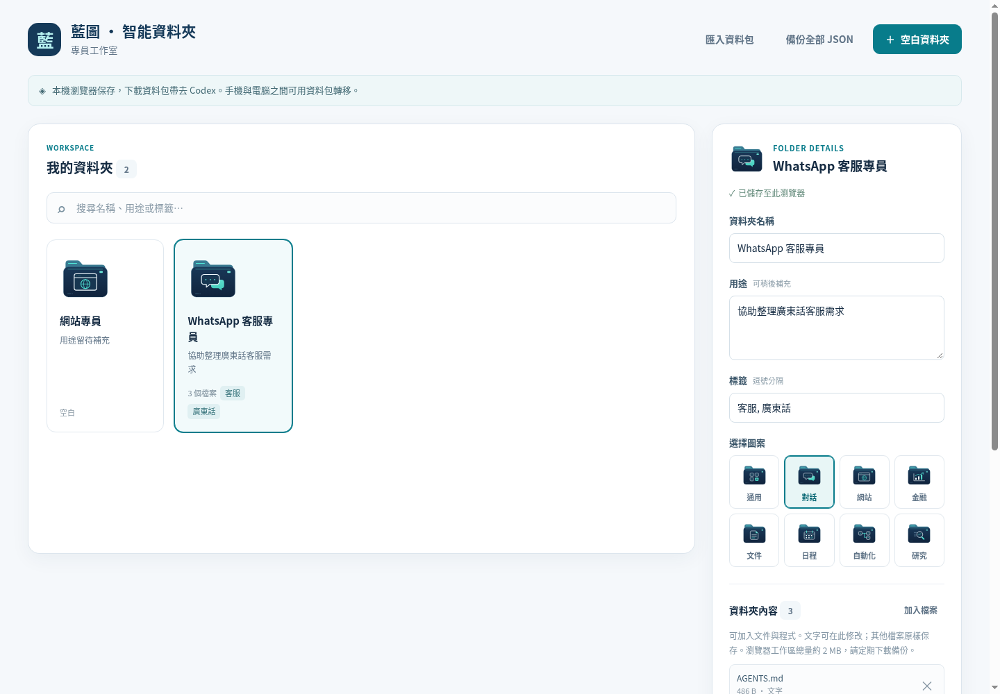

# 藍圖文件夾 Agent

一個普通文件夾，一張 AI 可讀身份卡，一套統一圖示。

Blueprint Folder Agent is a local-first folder marker and portable workspace
for use with Codex. Start with an empty folder and develop its purpose over time.

文件夾可以完全空白起步，無需預先設定工作目的。你與 Codex 溝通後，
再逐步加入內容、用途及標籤。這個小程式負責保存及展示資料，推理和開發由 Codex 提供；
程式不內置語言模型、不需要 API 金鑰、不連接雲端服務。



上圖為示範資料；首次開啟的工作區是空白的。

## 直接使用

下載並用瀏覽器開啟 **`dist/index.html`**。它是包含全部程式碼與圖示的單一 HTML，
無需安裝 npm 或 Python，也沒有 CDN 依賴。

1. 按「建立空白文件夾」，輸入名稱；用途及標籤可留空。
2. 選擇圖示，之後隨時編輯標記或加入小型文字檔案。
3. 下載 ZIP 資料包。解壓後，就是有身份標記的實際文件夾。
4. 在 Codex 開啟該文件夾，請它讀取身份卡及現有內容，再按照你的要求開發。
5. 將更新後的文件夾重新封裝為 ZIP，匯入介面繼續整理。

桌面及手機使用同一個 responsive 介面。手機建議透過 HTTPS 靜態網站開啟；
部分手機檔案預覽器不會執行本機 HTML。瀏覽器內的卡片保存在當前瀏覽器，
不會直接更改電腦／手機檔案系統，也不會自動跨裝置同步。
要轉移或備份，請下載 ZIP 或匯出 JSON；清除瀏覽器資料會清除本機清單。

圖示由本程式統一顯示，亦保存在資料包內。系統的檔案總管可能繼續使用系統圖示；
本程式不修改作業系統設定。

## 配合 Codex 建立實際文件夾

這部分需要 Python 3.10+，全部使用標準函式庫，**不用 pip install**。
在本專案目錄執行（你的環境可能用 `python` 或 `python3`）：

```sh
python3 blueprint.py init "/你的路徑/藍圖專員工作室"
python3 blueprint.py create "/你的路徑/藍圖專員工作室" "第一個文件夾"
```

第二行可以不填用途。之後再逐步補充：

```sh
python3 blueprint.py mark "/你的路徑/藍圖專員工作室/第一個文件夾" --description "協助整理客服回覆" --category chat --tag WhatsApp --tag 客服
python3 blueprint.py search "/你的路徑/藍圖專員工作室" "客服"
python3 blueprint.py inspect "/你的路徑/藍圖專員工作室/第一個文件夾"
```

可用圖案：`general`、`chat`、`web`、`finance`、`document`、`calendar`、`automation`、`research`。
`auto` 只按本機關鍵字建議圖案，並不是 AI 模型分類。空白名稱以外的用途資料可以留空。

可直接對 Codex 說：

> 請用這個專案的 blueprint.py，在我指定的工作室目錄建立一個空白文件夾。
> 先不要預設用途。之後每次開始工作，先讀 .blueprint/folder.json 及現有檔案；
> 按我們的對話逐步補充用途與標籤，保留既有身份編號及內容。

程式會建立：

```text
第一個文件夾/
├── AGENTS.md                 # Codex 工作指引；原有檔案不會被覆寫
└── .blueprint/
    ├── folder.json           # 名稱、身份、用途、標籤、圖案類型
    ├── icon.svg
    └── icon.png
```

父目錄的 `.blueprint/index.json` 和 `INDEX.csv` 會同步更新。
搬動或重新命名文件夾後，執行 `python3 blueprint.py reindex "工作室路徑"` 重建清單。

## 把 Codex 更新帶回介面

```sh
python3 blueprint.py pack "/你的路徑/藍圖專員工作室/第一個文件夾" --output "/另一個路徑/第一個文件夾.zip"
```

然後在瀏覽器版匯入 ZIP。會保留標記、文字、二進位檔案及既有 `AGENTS.md`。
封裝會略過 `.git`、`node_modules`、虛擬環境與 Python 快取；ZIP 上限 20 MB／5,000 檔。
瀏覽器本機保存的容量較小，適合標記及小型內容；大型程式庫請繼續保存在電腦或 GitHub。
封裝前請自行檢查內容，程式不會自動辨認或刪除你的憑證檔案。

## GitHub 與手機網址

GitHub 專案：[collieai-g/blueprint-folder-agent](https://github.com/collieai-g/blueprint-folder-agent)。
可直接[下載完整程式碼 ZIP](https://github.com/collieai-g/blueprint-folder-agent/archive/refs/heads/main.zip)。
把 `dist/` 目錄部署到任何靜態網站服務，就能在手機瀏覽器使用。
專案附有手動執行的 GitHub Pages workflow：先在 repository 的 Settings → Pages
選擇 GitHub Actions，再於 Actions 執行「Publish folder app」。這會公開瀏覽器介面；
文件夾內容仍只保存在使用者瀏覽器，程式沒有上傳內容的 API。
GitHub Pages 是否可用取決於 repository 可見度、帳戶方案及設定。

GitHub 雲端的檔案不會由本程式自動同步。要與 Codex 交換工作成果，使用資料包或 Git。

## 開發及驗證

```sh
python3 tools/build_web.py
python3 -m unittest discover -s tests -v
node --test tests/test_packager.cjs
python3 blueprint.py serve --no-open
```

圖示已包含在下載包內。只有重新製作圖示才需要 Pillow：
`python3 tools/build_icons.py`。

本程式沒有自動部署或執行其他 Agent 的功能；身份標記只記錄文件夾資料。

## 開源授權

本專案的程式碼、文件及自製圖示採用 [MIT License](LICENSE)，
Copyright (c) 2026 collieai-g。可以商業使用、修改及再發布，請保留授權及版權聲明。

Python CLI 使用標準函式庫；瀏覽器版沒有第三方執行依賴。
圖示由 `tools/build_icons.py` 的繪圖指令產生，沒有附帶第三方圖示套件。
Pillow 只用於重新產生圖示，沒有隨程式封裝；自行安裝的開發工具依其各自授權使用。
