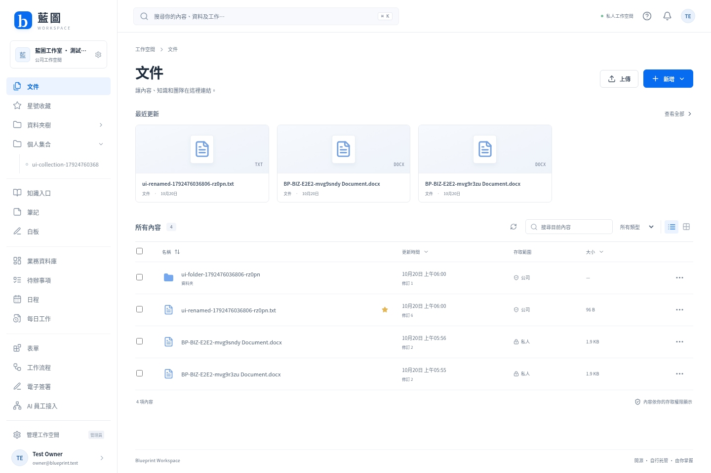

# Blueprint Studio Backend

**藍圖工作室（後台）｜免費、開源、可自行部署嘅公司營運工作台。**

Rust 核心、TypeScript 網頁、PostgreSQL 持久資料。每次安裝服務一間公司或個人，支援公司內不同業務、成員、部門及外部協作者。使用者自行選擇本機、私人伺服器或雲端。

此分支為 **v2.0.0-alpha.1 Rust 重寫開發版**。以公開 Box 文件、示範及介面行為作參考，建立獨立嘅藍圖產品。功能及企業容量須以實際測試報告為準；尚未配置嘅簽署、日曆、Office、掃描或 AI 接口會顯示設定需要，不會產生模擬成功。



[手機操作畫面](docs/screenshots/workspace-mobile.png) · [實際驗證紀錄](docs/V2-VALIDATION.md)

## 開始使用

需要 Docker／Compose v2。macOS／Linux：

```sh
git clone https://github.com/collieai-g/blueprint-folder-agent.git
cd blueprint-folder-agent
git switch rewrite/rust-workspace-v2
./scripts/v2/configure.sh ../blueprint-private
./scripts/v2/stack.sh ../blueprint-private basic up -d --build
```

Windows（PowerShell 7）：

```powershell
./scripts/v2/configure.ps1 -PrivateDirectory ../blueprint-private
./scripts/v2/stack.ps1 -PrivateDirectory ../blueprint-private -Profile basic up -d --build
```

開啟 `http://127.0.0.1:8787`。在自己電腦讀取私人 `.env` 中嘅 `BLUEPRINT_SETUP_TOKEN`，於首次設定頁建立公司及管理員。設定腳本會生成隨機秘密，保存在公開程式目錄以外；已有配置不會被覆寫。

[完整安裝、服務接駁、HTTPS 及備份說明](docs/V2-OPERATIONS.md)

## 一套可按公司配置嘅後台

- **文件及知識**：文件夾、收藏、版本、搜尋、預覽、分享、留言及知識入口。
- **業務資料庫**：自訂資料表、欄位、關聯、保存視圖、表單、看板、日曆及工作台。
- **日常營運**：工作紀錄、成果、決定、待辦、任務、公司日程及外部日曆連接。
- **工作流程**：草稿／啟用版本、觸發、條件、人工處理、外部 HTTP／AI 員工接口及執行紀錄。
- **公司管理**：成員、群組、角色、服務身份、權限、模組、操作紀錄及整合設定。
- **企業模組**：簽署、文件生成、掃描、資料分類、保存政策、歸檔及企業身份接駁。

AI 員工本身由使用者另外開發及連接；後台提供身份、資料範圍、派工及結果回報。它不會自行讀取未提供嘅聊天，也不會在沒有外部員工時冒充 AI 完成工作。

## 自架服務組合

```sh
# 加入 Office 轉檔、抽字／中文 OCR 及 ClamAV
./scripts/v2/stack.sh ../blueprint-private documents up -d --build

# 加入 SeaweedFS、Documenso CE、Keycloak 及 Collabora
./scripts/v2/stack.sh ../blueprint-private enterprise up -d --build
```

每個組合都使用免費可自行部署嘅組件。第三方帳戶、憑證、SMTP、OAuth、儲存及功能連接需要由部署者設定；公司內容保存在自己控制嘅資料庫與磁碟。軟件沒有強制訂閱，主機及使用者自選服務嘅費用由部署者承擔。

## 公開研究及功能規格

- [Box REA 功能／操作對照、來源及未知項](docs/BOX-REA.md)
- [Rust v2 接口與實作契約](docs/V2-CONTRACT.md)
- [整合依賴及驗收](docs/V2-INTEGRATIONS.md)
- [Metadata 容量實測、環境與限制](docs/V2-PERFORMANCE.md)

研究基準為 2026 年 10 月 20 日可取得嘅官方公開資料。沒有登入 Box 企業帳戶逐個按鍵測試；文件確認、公開觀察及藍圖設計決定分開記錄。Box SDK 原始碼不包含在藍圖成品內。

## 開發

需要 Rust 1.99.1、Node.js 24、PostgreSQL 17。設定自己的外置資料目錄及 `BLUEPRINT_DATABASE_URL`，再執行：

```sh
cd ui
npm ci
npm run build
cd ..
cargo test --locked
cargo run --locked -- server
# 另一個終端機，使用相同資料庫及 master key
cargo run --locked -- worker
```

已完成嘅首次公司設定、資料及附件需要在重新啟動後保持。更換程式不代表可以重建資料庫或刪除 volumes。

## 版本及授權

v2 採全新安裝，沒有舊 Python CLI／SQLite／離線資料包嘅相容層。原有 v1.5.0 內容可從 Git 歷史 `1c0cc360ea42316994319d74cf61bae503062360` 取得；現有私人資料不由重寫程序更改。

藍圖自製程式採用 [MIT](LICENSE)。外部自架引擎保留各自授權；例如 Documenso CE 為 AGPL-3.0、Collabora 主要為 MPL-2.0。商業服務及企業版專屬元件不包含在免費預設組合。桌面同步及裝置安全客戶端屬網頁版後續階段。
