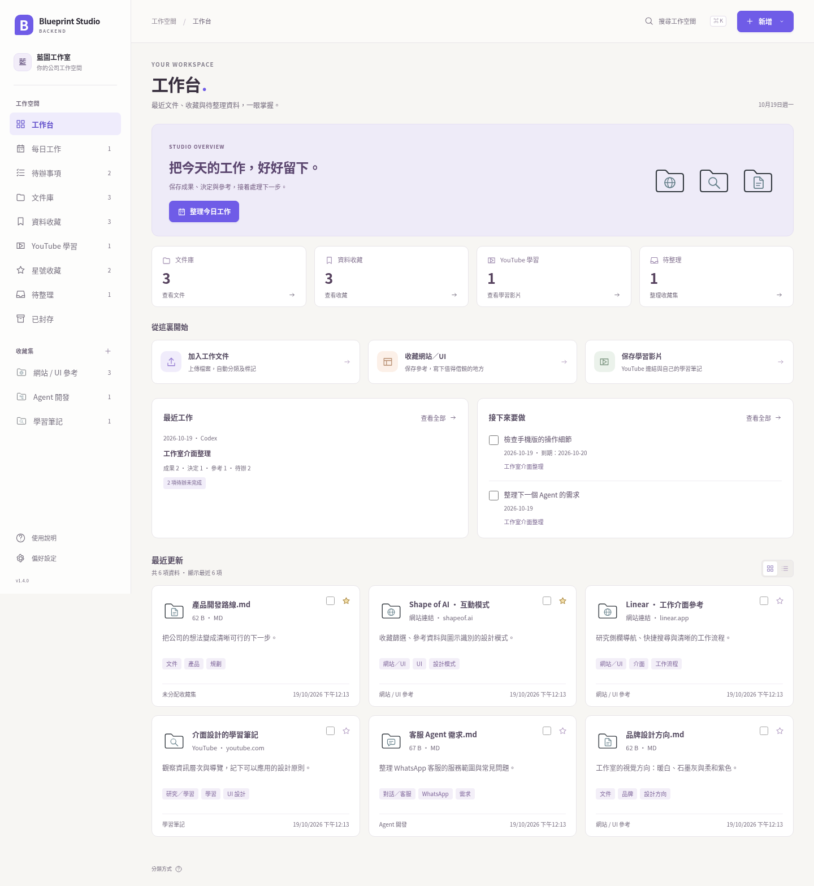

# Blueprint Studio Open Source

**藍圖工作室開源｜你公司的專屬後台。**

為管理公司大小事務而設，把每天的工作持續整理成公司的記憶。
說一句「今日收工」，由你接入的 AI 整合成果、決定、參考與待辦，留下有用內容，逐步累積及修整。
目前已提供公司設定、文件整理、資料收藏及每日工作；其他功能可按需要擴充。

[下載工具](https://github.com/collieai-g/blueprint-folder-agent/archive/refs/heads/main.zip) · [安裝指引](docs/INSTALL.md) · [更新紀錄](CHANGELOG.md)

## 貼給你的 AI，開始安裝

適用於具備專案、終端機或部署工具權限的 AI Agent，例如 Codex、Claude Code、Gemini CLI。
一般聊天 AI 亦可按同一份指引，帶你逐步操作。

```text
請幫我安裝 Blueprint Studio Backend，成為我公司的專屬後台。
公開工具：https://github.com/collieai-g/blueprint-folder-agent

先閱讀 README.md、docs/INSTALL.md 及 AGENTS.md，保留已有安裝、資料和修改。
1. 先問我的公司／創業名稱，以及行業、簡介、目前目標；後三項可以留空。
2. 再讓我選雲端（預設）或本機。雲端要問我已有的帳戶及平台偏好；
   沒有偏好時介紹 Render，亦可選 Railway 或自己的伺服器。
3. 公司資料與設定放在公開工具目錄以外。按所選模式繼續完成安裝，
   引導我登入雲端、設定永久儲存、管理員及 HTTPS 網址。
   涉及未授權收費時先核對方案；不要要求我把密碼或金鑰貼到聊天。
4. 實際驗證登入、公司資料、保存紀錄及重啟後查回，再說安裝完成。
   準備部署檔案不等於已上線；缺少工具時逐步指導我完成操作。
5. 接好我的 AI 工作室。以後我說「今日收工」，整理目前可見或我提供的工作，
   去掉閒聊、重複及無用內容；保存成果、決定、參考與待辦。
   合併及修改已有紀錄時保留版本歷史和待辦進度，不要建立重複日報。

最後告訴我真實使用網址、私人資料位置，以及仍未完成的步驟。
```

## 選擇使用方式

| 模式 | 適合誰 | 資料位置 |
| --- | --- | --- |
| **雲端（預設）** | 想用手機、外出或換電腦登入 | 你的雲端服務＋永久磁碟 |
| **本機** | 先在自己的電腦使用 | 工具目錄以外的私人資料庫 |

[開始 Render 雲端部署](https://render.com/deploy?repo=https://github.com/collieai-g/blueprint-folder-agent) · [Railway／伺服器步驟](docs/INSTALL.md#雲端使用)

雲端需要自己的帳戶及平台資源；由 AI 逐步帶你設定，費用以平台確認為準。
私人資料獨立保存，公開 GitHub 用來分享及更新工具程式。

## 每日一句「今日收工」

接好後，對正在使用的 AI 說：

> 今日收工，幫我整合今日工作，更新公司後台。

AI 會保留有用成果、重要決定、設計／學習參考及下一步；參考網址加入收藏，待辦可以勾選完成。
同一份工作可以合併新內容、修整或移除雜訊，修改歷史及完成進度保留。

AI 整理目前可見或你明確提供的對話；工具不會自行讀取各平台未提供的聊天。
沒有工具權限的 AI 可輸出整理結果，貼回後台預覽、修改及保存。

[每日工作與 AI 連接說明](docs/DAILY_WORK.md)

## 目前可以做甚麼？

- **公司設定**：名稱、行業、簡介與目標，保存在自己的後台。
- **文件整理**：保存原檔、分類、標籤及統一線條圖示。
- **資料收藏**：保存網站、UI 參考、YouTube 與學習筆記。
- **工作管理**：每日紀錄、版本歷史、待辦、星號及快捷搜尋。



以上使用示範資料。[手機介面](artifacts/backend-mobile.png) · [公司設定](artifacts/backend-company.png) · [每日工作示例](artifacts/backend-workday.png)。
分類目前使用本機規則；收藏網址未有自動讀取網頁全文或影片字幕。

## 更新工具

在共用工具目錄檢查修改後執行 `git pull --ff-only`，再重新啟動本機服務或重新部署雲端服務。
保留原本資料路徑／雲端磁碟，公司內容可繼續使用。「今日收工」更新的是工作資料。

舊版文件夾與離線資料包工具保留，見[詳細用法](docs/USAGE.md)。
後台儲存、備份及自行部署見[公司後台說明](docs/LIBRARY.md)。

## 開源與參與

目前版本 **1.5.0**。程式碼、文件及自製圖示採用 [MIT 授權](LICENSE)，可以使用、修改及分享。
歡迎提交 [Issues](https://github.com/collieai-g/blueprint-folder-agent/issues) 或 Pull Request。
[更新紀錄](CHANGELOG.md) · [驗證紀錄](VALIDATION.md)
