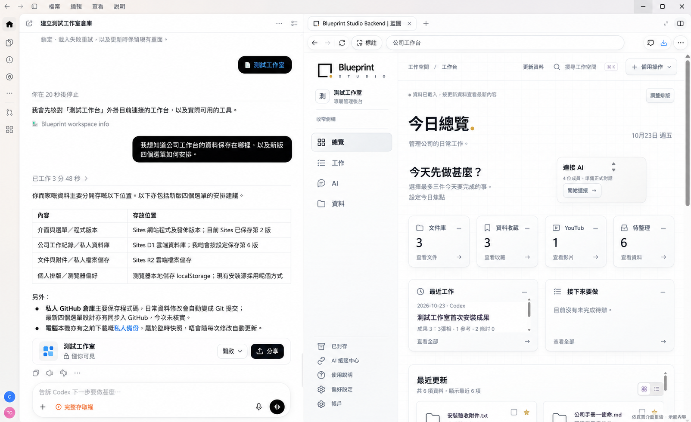

<p align="center">
  <a href="https://blueprint-agent-studio.onrender.com/">
    <picture>
      <source media="(prefers-color-scheme: dark)" srcset="assets/brand/mark-light.svg">
      
    </picture>
  </a>
</p>

<h1 align="center">Blueprint Studio Open Source</h1>

<p align="center"><strong>在左側指揮 Codex，在右側管理公司。</strong></p>

<p align="center"><strong>繁體中文</strong> · <a href="README.en.md">English</a></p>

<p align="center">
  <a href="docs/USER_GUIDE.md">開始使用</a> ·
  <a href="#first-install">首次安裝</a> ·
  <a href="#keep-updated">更新工作台</a> ·
  <a href="https://github.com/collieai-g/Blueprint-Studio-Open-Source/releases/latest">下載正式版</a> ·
  <a href="https://blueprint-agent-studio.onrender.com/">官方網站</a>
</p>

**藍圖工作室是為創業者和小型公司而設的開源工作台，讓你沿用 Codex 處理公司的日常工作。** 你在左側的 Codex 原有介面交代目標；右側開啟自己公司真正使用的藍圖工作台，查看文件、項目、待辦和成果。



*依真實介面重繪／示範內容，參考較早的左右介面；文字與成果狀態不作實際保存證據。此圖不是 V2.7.4 的預設畫面：新版總覽只有標題與排版入口，AI 接駁在左側完成。*

這是兩個實際介面的配合：

| 左側：Codex 原有介面 | 右側：你的藍圖公司工作台 |
| --- | --- |
| 你在原本的 Codex 對話中提出要求、核對處理過程並給予指示。 | 你登入自己的公司工作台，選擇資料，查看工作進度及保存結果。 |
| Codex 沿用客戶端提供的 AI 工作流程、自動化及已授權工具執行工作。 | 藍圖提供公司管理介面、資料保存、權限、版本及 Skill 交接。 |

左右排列由客戶端或你的視窗安排提供。藍圖配合原有 Codex 使用，沒有把 Codex 重新製作成工作台內的聊天介面。

## V2.9.0：調整版面更簡單，更新不用重做

常用的選取與顯示／隱藏留在前面，尺寸、文字及重設收進「更多調整」，可復原上一步。安裝更新按同一計劃續行，資料未變時沿用有效備份；排版接續檔只在需要時匯出。詳見[共用流程](docs/INSTALL_UPDATE_FLOW.md)及[版本說明](docs/RELEASE.md)。GitHub 來源更新不代表私人工作台已部署。

## V2.8.1：讓 Codex、分頁與裝置共用個人版面

修正排版只留在單一瀏覽器的限制。卡片位置、大小、顯示文字、每頁配置及總覽引用經已登入後台保存；同一帳戶的可見網頁約每兩秒檢查更新。Codex 可使用新增的版面讀寫工具，先讀版本、修改並讀回。編輯中保留草稿，衝突不會無聲覆蓋。

資料格式仍為 **schema 7**。需同時更新相容後台與介面；純 Sites 須接上其既有身份及儲存適配。GitHub 更新不會自動部署私人工作室。見[版面同步](docs/PRESENTATION_SYNC.md)及[發行說明](docs/RELEASE.md)。

## V2.8.0：讓獨立服務接入公司工作台

原生後台新增 [Blueprint Integration Contract 1.0](docs/INTEGRATION_GUIDE.md)：外部服務以專用有限權限憑證提交紀錄、讀取獲授權資料及取得持久指令，再回報實際執行結果。指令先顯示待處理，外部確認後才改變狀態；重試、來源版本及可恢復同步由伺服器檢查。每個私人資料目錄仍代表一家公司。

已註冊服務可在「工作 → 外部工作」查看紀錄及結果。原有四個入口、左側 AI 設定及簡潔總覽保留；沒有服務時不顯示外部工作入口，也不新增接駁精靈。WhatsApp、模型、DOT 及對外發送由獨立服務負責。

**2.8.0 來源新增 schema 7，需完整原生後台更新與備份演練，不能只替換介面。** Sites 自身後台須另行適配。產品版本、整合合約 1.0 及原有 `blueprint-agent/1` 分開管理；本次來源變更不代表已發佈正式版或更新任何私人／測試工作台。詳見[發行說明](docs/RELEASE.md)及[升級指南](docs/UPGRADE.md)。

## 為創業者和小團隊而設

創業者需要把會議、文件、項目、待辦及每天的工作成果持續整理，並讓 AI 協助推進。藍圖把這些公司資料放到可查找、跟進和重用的工作台，Codex 負責理解你的要求及使用實際可用的能力處理工作。

項目的目標是沿用 Codex 已有的 AI 工作流程和工具能力，減少重建通用 AI 對話、控制及自動化層的開發成本，把開發資源放在公司的管理流程、資料和專業需要。實際可用的自動化，仍取決於目前客戶端真正提供並獲授權的工具。

藍圖的共用後台及介面保持開源，可按業務需要修改；影片設計等專業流程可透過 Skill 重用。Skill 提供方法，Codex 配合已有工具執行，藍圖保存材料和成果；不需要為每一個部門另行建立一個模型服務。

## 先完成一項真實工作

1. **把兩邊放在一起。** 在平常使用的 Codex 開啟對話，把已安裝的藍圖工作台開在右側瀏覽器，或放到旁邊的另一個視窗。
2. **指定這次工作。** 在藍圖上載或選定資料，再向左側 Codex 說明要做甚麼。
3. **查看保存結果。** Codex 使用目前可用的正式操作保存成果；重新開啟同一筆紀錄，核對文字、待辦及附件。

例如，你可以在左側說：

> 根據我選定的會議紀錄，整理決定和三項待辦，放到這個項目。保存後重新開啟同一筆紀錄，讓我核對。

Codex 若真正具備控制同一個已登入工作台的工具，就可以點擊、填表和上載，你不必另寫 API。MCP 是另一條可選工具路線。**看得到右側網頁、能控制它，以及保存成功，是三件不同的事。** 藍圖後台仍負責登入、權限、版本檢查及私人儲存。

尚未安裝時，先用下方[首次安裝指令](#first-install)。已可開啟工作台時，跟著[使用指南](docs/USER_GUIDE.md)完成第一項工作；詳細分工見[左右協作流程](docs/LEFT_RIGHT_WORKFLOW.md)。

## 右側四個入口，接住每天的工作

| 入口 | 你在藍圖查看甚麼 | 可以交給左側 Codex 的工作 |
| --- | --- | --- |
| **總覽** | 預設標題與排版入口；需要時加入資料卡片 | 「整理今天的重點，保存到工作及待辦。」 |
| **工作** | 項目、收件匣、待辦及工作紀錄 | 「整理進度，更新這個項目的待辦。」 |
| **AI** | Skill 與交接、相容 Agent 及工作指令 | 「按這份影片 Skill 和選定素材準備製作。」 |
| **資料** | 文件、收藏、主題及釘選內容 | 「把這份報告和參考網址整理到同一個主題。」 |

工作台保留白色、淺灰色及淡方格。總覽的卡片由你按「調整排版」選擇加入，再移動、調整大小或收合；支援同步的後台會把排版保存到自己的帳戶，供同一工作室的分頁及裝置共用。細分內容放在各頁面，舊紀錄、權限及保留路由繼續可用。

左下角只保留「設定」，集中帳戶、使用說明及選用的進階 AI 接駁；「已封存」放在「資料」內，仍可查看和還原。

閒置或切回視窗時，畫面不會自動重建。工作台內保存後更新相應內容；Codex 從外部工具保存後，按「更新資料」查看。

[公司日常管理例子](docs/USER_GUIDE.md#每天可以怎樣使用) · [個人排版](docs/LAYOUT.md) · [功能與實際範圍](docs/V2.4.md)

## Skill 提供方法，工具完成製作

例如要做個人化影片：在「AI → Skill 與交接」選擇影片工作，填寫目標、片長及風格，選定品牌素材。Codex 根據 Skill 準備腳本、分鏡，再使用目前真正可用的影片或剪輯工具製作，將實際成果存回藍圖。

可重用的 `SKILL.md` 保存專業流程；私人交接單保存本次要求及所選資料引用。兩者可以分開下載，交接單也可保存成同一後台的報告，沿用來源權限。匯出來源編號不包含原始附件，仍須經獲授權方式讀取。

下載 Skill 不會自動安裝外掛或啟動 Codex。沒有影片工具時，先交付腳本及分鏡，成片保持待完成；不需要為每種影片另建一個常駐 AI 服務。

[影片工作完整例子](docs/USER_GUIDE.md#製作一段個人化影片) · [可重用影片 Skill 範本](templates/skills/personal-video/README.md)

## 日常保存，不用每次重新部署

整理報告、更新待辦、收藏資料和修改既有設定，使用現有畫面或已授權工具保存即可，不需要 Git 提交或重新發布網站。只有修改藍圖程式、按鈕邏輯、加入尚未支援的能力或升級版本，才需要測試及部署。

這個公開倉庫保存可重用程式與文件。公司資料、附件、私人偏好、憑證及完整備份放在另外的私人位置。一般對話不會整段自動存入，藍圖也不會自行讀取其他平台的私人聊天。

[主要運作方式](docs/OPERATING_MODEL.md)說明日常管理、公司私人程式版本、Skill 與 Agent 的分工。

## 安裝與更新

安裝入口是 [INSTALL_AI.txt](INSTALL_AI.txt)；AI 接駁入口是 [AI_CONNECT.md](AI_CONNECT.md)，兩者由左側 AI 閱讀及執行。

本機安裝在你自己的電腦運行；雲端安裝提供可登入的網站。AI 每次先核實最新正式版本，沿用已選定的平台和資源。原生安裝須驗證完整備份下載、隔離還原、重啟保存及日後更新途徑；詳細流程由安裝 AI 閱讀。

<a id="first-install"></a>
<a id="貼給你的-ai開始安裝"></a>

### 1. 第一次安裝

開啟有安裝或部署工具的 AI 對話，複製以下指令。

<details>
<summary>展開首次安裝指令</summary>

```text
請幫我首次安裝 Blueprint Studio Open Source，並用繁體中文逐步帶我完成。
先讀取並遵循最新安裝入口：
https://github.com/collieai-g/Blueprint-Studio-Open-Source/blob/main/INSTALL_AI.txt

核實最新正式版本，固定本次 tag 與 commit。先檢查這個 AI 平台的實際工具，再帶我選本機或雲端；已有選擇便沿用。
請完成原版介面、登入、持久儲存、AI 真正寫入與讀回，並在工作台核對相同結果，再帶我完成第一項工作。需要我操作時，只給當前一步的入口、動作及成功標誌。
私人資料及安裝進度保存在公開倉庫以外。先沿用我已選定的目標：若我明確要求全新安裝並保留舊站，使用獨立服務及資料位置，舊站不動；不要因找到舊站而轉去更新，也不要以舊站備份作為新安裝前置條件。只有我要更新原工作台時，才改按 UPDATE_AI.txt 保留資料更新。
```

</details>

已有舊站但想另裝時，加上「全新安裝原生工作台，保留舊站不動」。新服務使用獨立資料及備份位置，舊資料不自動匯入。

<a id="keep-updated"></a>

### 2. 之後每次更新

把以下指令貼到管理現有工作台的 AI，保留原網址、登入、資料、附件與自訂內容。

<details>
<summary>展開更新工作台指令</summary>

```text
請幫我把現有 Blueprint Studio Open Source 工作台更新至最新正式版本。
先讀取並遵循最新更新入口：
https://github.com/collieai-g/Blueprint-Studio-Open-Source/blob/main/UPDATE_AI.txt

核實並固定本次目標 tag 與 commit，沿用原網址、登入、資料、附件及自訂內容。尋找已有的私人進度與來源檢查點，直接接續。
先核對完整且可還原的備份，再整合新版、部署原服務、核對舊資料與新版畫面，最後驗證目前 AI 真正寫入及讀回同一筆結果。不要停在只保存程式或下載安裝包。
所有私人來源、資料、設定及備份都保存在公開倉庫以外。缺少必要能力時，說清楚具體缺項與下一步，分開回報網站更新和 AI 接駁的狀態。
```

</details>

GitHub 發版不會自動更新你的工作台；AI 需完成備份、整合、原服務部署及驗收。跨對話時，沿用既有私人進度及已核實來源，不重建資料。

若 AI 不能讀取 GitHub，可下載[最新正式版](https://github.com/collieai-g/Blueprint-Studio-Open-Source/releases/latest)中以 `-installer.zip` 結尾的完整安裝包，交給 AI 讀取包內入口。`-workbench.zip` 只有介面，不能代替完整後台。

[完整安裝指南](docs/INSTALL.md) · [本機安裝](docs/INSTALL_LOCAL.md) · [雲端安裝](docs/INSTALL_CLOUD.md) · [備份與更新](docs/NATIVE_LIFECYCLE.md)

## 客戶端、接駁與開發

Codex 及其他相容 AI 能做甚麼，取決於目前客戶端實際提供的工具。畫面控制需要能操作正確的已登入分頁；只有聊天或網頁預覽時，可準備指引和檔案，不能宣稱已操作工作台。AI 設定一律先在左側讀 [AI_CONNECT.md](AI_CONNECT.md)。選用 MCP 時，再按[技術接駁指南](docs/AI_CONNECTION.md)及[驗收流程](docs/CONNECT.md)核對真正工具讀寫，無需右側精靈。

本項目提供 42 個共通 MCP 工具；原生及 Sites 原生接駁另有六個擁有人維護工具，共 48 個。這些是可選的工具接駁能力，不是畫面操作路徑的必裝前置條件。

目前有可運行的 Python 本機／雲端後台，以及 Docker、Render、Railway 等部署指引。[Sites 入口配原生後台](docs/SITES_NATIVE_GATEWAY.md)提供另一種接駁方式；Sites 自身儲存資料的路線仍需相應後台及備份適配，沒有無設定的一鍵完整部署。

需要固定套件版本、來源摘要及持久工作狀態時，可使用[Agent 工作規格](docs/AGENT_CONTRACT.md)、[開發範本](templates/agent/README.md)及[獨立摘要示範](https://github.com/collieai-g/collieai-g-Blueprint-Agent-Summary)。它不是每份 Skill 的前置條件；登記或連接接口不代表正在運行客服、影片或其他背景 AI。

<details>
<summary>查看歷史工作台畫面</summary>


這是 V2.4 的歷史截圖，並非目前四個主入口的畫面。[歷史手機截圖](artifacts/studio-v2.4-mobile.png)。

</details>

## 文件與參與

想把測試中發現的問題修正到開源項目，先讀[參與貢獻](CONTRIBUTING.md)與[開發流程](docs/DEVELOPMENT.md)。以合成資料重現、修改對應元件並提交可審閱 PR；私人工作台內容另存。相關[驗收規則](docs/DEVELOPMENT_ACCEPTANCE.md)、[私隱規則](docs/PRIVACY.md)與[分批計劃](docs/DEVELOPMENT_PLAN.md)說明交付範圍。

藍圖以 Codex 為主要協作環境，將開發集中在公司的材料、專業做法、工作介面與成果。方向見[專用工作台設計與開發指示](docs/HARNESS_ENGINEERING.md)及[企業工作台參考](https://github.com/collieai-g/Blueprint-Studio-Open-Source/blob/main/research/codex-workbench-reference.md)；新增自動檢查與測試 Harness 保留於[下一版候選](docs/HARNESS_VALIDATION_NEXT.md)。

| 你想了解 | 文件 |
| --- | --- |
| 開啟左右介面，完成第一項日常工作 | [使用指南](docs/USER_GUIDE.md) |
| 左右協作、Skill 與影片流程 | [協作流程](docs/LEFT_RIGHT_WORKFLOW.md) · [主要運作方式](docs/OPERATING_MODEL.md) |
| 安裝與每日工作 | [開始使用](START_HERE.md) · [完整安裝](docs/INSTALL.md) · [每日工作](docs/DAILY_WORK.md) |
| 更新、備份及回復 | [更新路線](docs/UPDATE_ROUTE.md) · [升級指南](docs/UPGRADE.md) |
| 自行部署或開發 | [後台說明](docs/LIBRARY.md) · [平台適配](docs/STUDIO_API.md) · [Agent 路線](docs/AGENT_ROADMAP.md) · [文件夾工具](docs/USAGE.md) |
| 版本與驗證 | [正式發行版](https://github.com/collieai-g/Blueprint-Studio-Open-Source/releases/latest) · [更新紀錄](CHANGELOG.md) · [驗證紀錄](VALIDATION.md) |

**關於 Blueprint Studio** — 讓 AI 協助工作，讓公司的日常有序保存。[官方網站](https://blueprint-agent-studio.onrender.com/)介紹品牌及客製化服務。

README 提供繁體中文與英文；詳細指南及工作台介面目前以繁體中文為主。採用 [MIT 授權](LICENSE)。歡迎透過 [Issues](https://github.com/collieai-g/Blueprint-Studio-Open-Source/issues) 或 Pull Request 提出改進，分享例子時請使用測試資料。
