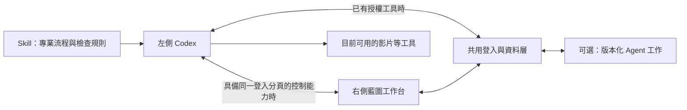

# Skill 與 Agent 共用工作台

**左側 Codex 執行工作，右側藍圖管理材料與成果；Skill 提供可重用的專業方法。** 影片設計、報告整理或客服草稿，優先使用 Skill 配合目前已有的工具。需要固定設定快照、來源核對及持久工作狀態時，再使用既有 Agent 工作規格。

日常對話保留在原有 Codex。藍圖提供上載、選定資料、工作說明、操作及結果介面，無須為每個部門再開發一個模型服務。完整分工見[主要運作方式](OPERATING_MODEL.md)及[左右協作流程](LEFT_RIGHT_WORKFLOW.md)。

## 共用介面與實際操作路徑

藍圖保留白色、淡方格與原有標誌，主要導覽為「總覽、工作、AI、資料」。在「AI」準備 Skill 及單次工作說明，或開啟既有 Agent 工作台。一般專業流程不需要先登記 Agent、安裝新外掛或發布網站。

使用者偏好畫面操作，而且目前客戶端確實可控制同一個已登入的工作台時，Codex 可透過正式表單完成資料工作，保存後重新查看相同紀錄。使用者不必另外編寫 API 呼叫。網頁底層仍使用同一個已登入資料服務，保留權限、版本及歷史。

右側看得到網站，不代表 AI 已取得操作權。若目前沒有控制工具，可用已接通的藍圖 MCP／工具；兩者都沒有時，先交付可用指引、工作說明及成果檔案，清楚記錄哪些內容尚未存入藍圖。Skill 匯出、客戶端載入、工具可用和工作完成各自驗證。

## Skill 與單次工作分開

| 內容 | 保存甚麼 | 使用方式 |
| --- | --- | --- |
| 可重用 Skill | 工作流程、風格原則、檢查方法及輸出規格 | 由目前客戶端按其正式方式載入，Codex 讀取及運用 |
| 單次工作說明 | 本次目標、限制、公司偏好及選定來源 | 經使用者交給目前對話，只用本次獲授權資料 |
| 實際工具 | 瀏覽器控制、生成、剪輯、轉檔等能力 | 依目前對話真正具備的工具和授權執行 |
| 藍圖資料與成果 | 私人材料、工作紀錄、附件、結果及來源 | 經現有畫面或已授權工具保存後讀回 |

Skill 工作台把使用者填寫的欄位整理成指引草稿及交接內容；需要理解材料、設計專業方法或生成外掛程式時，由左側 Codex 處理。上載資料本身不會啟動另一個模型。影片工具未提供時，可以完成腳本及分鏡，不能宣稱已產生成片。

可先使用[個人化影片範本](../templates/skills/personal-video/README.md)，逐步調整私人風格偏好。公開範本只放可重用方法；公司素材、偏好、工作記錄和憑證留在私人位置。更新 Skill 不會自動安裝到其他客戶端，也不會改寫舊工作成果。

## 可選的版本化 Agent 工作

V2.6 已提供 `connected_client` Agent 套件登記與工作記錄。這適合需要以下能力的工作：固定套件來源、保存設定快照、核對來源版本、追蹤開始及終止狀態。它不是每份 Skill 的安裝前置條件。

開發者可在獨立來源提供 `agent.json`，審核固定 commit 後按[接駁規格](AGENT_CONTRACT.md)登記。套件宣告身分、規則、設定、操作和共用介面；加入網址不會下載、安裝或執行倉庫程式，介面也不載入任意 HTML 或 JavaScript。

啟用 `connected_client` 接口只表示後台可準備交接工作，不證明目前 Codex 對話已載入工具。既有專員設定不會自動變成已運行的客服、影片或其他業務服務。

版本化工作沿用原有流程：

1. 在藍圖選擇 Agent、操作及獲准來源，建立工作。
2. 使用者在目前 Codex 對話要求處理。工作台可以複製交接內容，不會自行喚起對話。
3. Codex 讀取最新上下文，核對規則、設定、來源及 `context_digest`，再用正式操作開始工作。
4. 使用目前已授權能力處理；完成時保存真實結果、實際客戶端名稱、來源引用和相同上下文摘要，失敗時保存原因。
5. 讀回同一項工作，確認工作台顯示一致結果。

狀態保持 `awaiting_codex → in_progress → completed / failed`，亦可取消未完成工作。終止狀態不可改寫，重做時建立新工作。開始後來源或權限改變，不可把過期結果保存為成功。

一般設定可經畫面或工具修改；目前 Agent 工作的開始與完成需使用已提供的正式工具／API。除非畫面已實作相同的生命週期操作，不能把瀏覽器控制當作繞過來源摘要及狀態檢查的方法。共用底層及協定保持相容，新的畫面操作應接到同一組檢查。

## 開發與驗收

[Agent 開發範本](../templates/agent/README.md)及[獨立摘要示範](https://github.com/collieai-g/collieai-g-Blueprint-Agent-Summary)保留，供需要版本化工作的人驗收接駁。示範的推理由目前 AI 對話完成，不是後台自動摘要服務。

| 驗收 | 成功標誌 |
| --- | --- |
| 畫面控制 | 操作正確的已登入工作台，保存後重新查看相同紀錄 |
| Skill 與材料交接 | 目前對話可讀取正確 Skill，並取得本次獲准材料；來源編號不冒充附件全文 |
| 真實製作 | 生成或剪輯工具回報完成，實際成品可開啟並核對 |
| Agent 開始、完成及讀回 | 相同工作編號、來源摘要、實際結果及終止狀態 |
| 設定與資料保護 | 過期修改回報衝突，無權使用的來源及衍生結果不可見 |
| 穩定畫面 | 閒置或切回視窗不觸發資料更新，手動更新及保存後顯示正常 |

自動測試驗證介面、交接格式、協定、儲存及權限。正式驗收還需確認當前客戶端真正可控制畫面或使用工具，以及真實產出、保存和讀回。測試文字、工具清單、可見畫面及 GitHub 提交，都不能代替實際處理與正式部署。

## 後續範圍

藍圖目前不包含背景 AI 執行器。`/api/runtime` 的 `agent_executor: not_configured` 表示沒有常駐執行服務，不妨礙目前對話使用 Skill 處理工作。關閉對話後不會由藍圖接手思考，等待或逾時也不會令工作自動成功。

自動啟動 AI、離線持續運行、排程及對外渠道，按實際需要另外設計。只有新的可執行能力才需要新增工具或外掛；公司長期客製程式由私人來源維護，保留既有修改後再整合上游。日常資料、既有設定與相容 Agent 登記仍直接保存，無須每次 Git 提交或重新部署。
