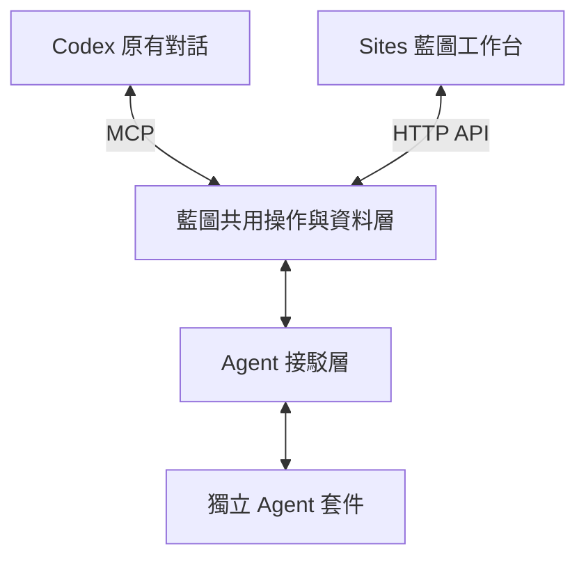

# Agent 共用工作台

**Codex 理解要求並推進工作；藍圖管理資料、操作與結果；獨立 Agent 提供專業規則及功能。** 日常對話保留在原有 Codex，藍圖提供同時可操作的工作台。相容 AI 客戶端也可以使用同一組已授權工具。

2.6 首階段服務開發者自己的試用。客服 Agent 只是架構參考，這次沒有接駁客服、WhatsApp、模型 API、排程或常駐執行器。`/api/runtime` 的 `agent_executor: not_configured` 仍然表示沒有背景 AI 執行服務；不代表無法由目前對話處理工作。

## 共用介面與獨立倉庫

藍圖保留現有白色、淡方格、標誌及五組導覽，在「AI 專員」加入 Agent 工作台。每個 Agent 使用獨立 GitHub 倉庫及版本，按[共同接駁規格](AGENT_CONTRACT.md)提供身分、規則、設定、操作和介面描述。共用畫面負責呈現欄位、操作、工作及結果；首版不載入套件提供的任意 HTML 或 JavaScript。

開發者先審核固定 commit 的 `agent.json`，再登記來源與套件。加入網址不會下載、安裝或執行程式。登記與連接分開：啟用 `connected_client` 接口後，可以準備交給目前 AI 對話的工作；這個狀態不證明目前對話已載入 MCP 工具。

舊有專員設定仍然保留。它們不會自動變成已接通的 Agent，也不會因新功能而開始對外回覆。

## 兩個入口處理同一項工作

一般設定由工作台按鈕或 MCP 直接保存，兩者使用同一個 API、登入權限及版本檢查。AI 工作採用以下交接：

1. 在藍圖選擇 Agent、操作和獲准資料，建立「等待 Codex」的工作。
2. 在 Codex 說「處理 Agent 工作 `<工作編號>`」。工作台可以複製這句交接文字，但不會喚起對話。
3. Codex 讀取工作上下文，核對 Agent 規則、輸入、來源及 `context_digest`，再開始工作。
4. Codex 使用目前已有且獲授權的能力處理工作，保存結果、實際客戶端名稱及引用來源；失敗則記錄原因。
5. 讀回同一筆工作。藍圖顯示相同結果及狀態。

狀態為 `awaiting_codex → in_progress → completed / failed`；未完成工作也可取消。終止狀態不能改寫成另一個結果，重做時建立新工作。工作建立時固定套件版本、規則與設定；往後修改 Agent 設定不會悄悄改寫既有工作。

關閉對話不會讓藍圖接手思考。中斷工作保持其最後已保存狀態，不能只因等待或逾時就標示完成。來源變更、權限改變或版本衝突會阻止過期結果保存，使用者可重新讀取後決定下一步。

## 開發與驗收

使用[開發範本](../templates/agent/README.md)建立各自的 Agent 倉庫。首個[獨立摘要示範](https://github.com/collieai-g/collieai-g-Blueprint-Agent-Summary)已發佈到 GitHub，只把使用者指定資料整理成摘要，推理工作由目前 AI 對話完成。示範來源有獨立 Git 歷史；GitHub 發佈與正式接駁須分開驗證，不能把本機倉庫當成已公開的遠端服務。

| 驗收 | 成功標誌 |
| --- | --- |
| 藍圖建立工作、MCP 讀取 | 相同工作編號、輸入和已選來源 |
| Codex 開始、完成及讀回 | 保存實際摘要、來源和完成狀態，工作台顯示同一結果 |
| 兩邊修改設定 | 相同設定版本，過期寫入回報衝突 |
| 未連接、失敗或取消 | 狀態及原因可見，不顯示成功結果 |
| 重啟與資料保護 | 工作仍然存在；無權使用的來源及衍生結果不可見 |

自動測試只能證明協定、儲存、權限及介面行為。測試注入的文字不是 Codex 真正完成摘要的證據；正式安裝仍須完成目前對話的工具載入、實際處理、讀回及畫面驗收。Sites 入口也須在實際平台驗收，不能把本機測試當作已上線。

## 後續範圍

按鈕自動啟動 AI、離線持續運行、排程、外部渠道及對外發送，之後按需要另行設計。首階段先把共同規格、Agent 範本、獨立示範及雙入口交接做好。

程式、套件規格及範本可以公開；公司資料、憑證、設定實例和工作記錄留在私人後台。修改業務資料經 API 立即保存；修改 Agent 程式或宣告則經自己的倉庫版本審核，再登記新版本，不能把兩者當成同一種修改。
