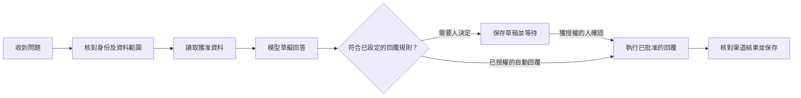

# Agent 架構與客服路線

本頁是後續開發設計，**不是已運行的客服 AI**。目前已有專員設定、工作記錄、資料權限及 MCP 工具；尚未附模型呼叫、常駐 Agent 執行器或自動對外發送。`/api/runtime` 會如實回報 `agent_executor: not_configured`。[參考來源與取捨](ARCHITECTURE_LEARNING.md)說明哪些底層做法參考 FastGPT；下列實作由藍圖獨立設計。

## 使用者看見甚麼

保留現有白色、淡方格、原版標誌及五組側欄。客服專員原有的「總覽／設定／對話／測試／數據」繼續使用，不新增另一個複雜編排畫布作為必經入口。AI 可協助設定步驟，進階使用者才展開細節。

第一個完整場景是：收到問題 → 找到獲准引用的公司資料 → 草擬有來源的回答 → 需要時交人確認 → 保存回覆與處理結果。沒有相關資料時轉人工，不猜價格、退款承諾或客戶資料。

## 後台分工

| 層 | 責任 | 不應混入的內容 |
| --- | --- | --- |
| 工作台與 Sites 入口 | 顯示進度、讓人查看草稿及作決定、提供 MCP 入口 | 模型密鑰、直接繞過資料權限、聲稱頁面開啟就是 Agent 上線 |
| 任務執行器 | 排程步驟、保存狀態、限制重試與成本、接續中斷工作 | 寫死某家模型名稱、把任意模型文字當可執行程式 |
| 模型介面 | 將各供應商輸入／輸出轉為共同事件，回傳實際用量 | 直接持有全公司資料、自己批准工具權限 |
| 工具登記 | 驗證參數、權限、資料範圍、結果及重複執行規則 | 相信模型傳來的使用者 ID、管理員角色或批准標記 |
| 公司資料與任務紀錄 | 保存來源、版本、草稿、批准、結果及可還原備份 | 寫入開源 GitHub 或瀏覽器作唯一正式副本 |

MCP 是 AI 客戶端使用工具的入口；Agent 執行器是持續處理任務的後台。兩者可以共用業務 API，但安裝 MCP 不等於已有常駐客服。支援模型與支援某個 AI 軟件的外掛登入亦是兩件事。

## 執行規則

1. **先保存工作，再開始執行。** 任務固定 `run_id`、工作流程版本、輸入來源及責任帳戶；每一步另有穩定 `step_id`。版本更新不把正在執行的任務悄悄換成新流程。
2. **狀態可接續。** 規劃 `queued → running → waiting_for_approval / succeeded / failed / outcome_unknown / cancelled`。等待人工時釋放執行資源，批准紀錄及草稿內容的雜湊一併保存；草稿改變後原批准失效。
3. **工具權限由伺服器計算。** 有效範圍是「責任帳戶、專員設定、工具權限、個別資料存取」的交集。客服不得讀取無關人事、財務或其他客戶內容。文件、網站與客戶訊息視作資料，不能用來修改系統規則。
4. **重試要分種類。** 查詢可有限重試；資料寫入使用穩定操作 ID 並讀回核對。外發回覆逾時時可能已送達，先查渠道回執；沒有查詢或去重能力便標為 `outcome_unknown` 等人處理，不能盲目再發。
5. **模型可替換但不自動擴權。** 第一階段只實作一個真實供應商介面，保留統一的文字、工具請求、用量及錯誤事件。之後逐家驗證 Claude、Grok 等相容方式；不能只改名稱便聲稱全部支援。後備模型沿用相同資料及工具限制。
6. **限制在呼叫前生效。** 每次執行限制步數、時間、輸入大小、工具次數及預算；預留可能費用，收到實際用量後結算。不能把事後登記費用當成能阻止超額扣費。
7. **記錄有用證據。** 保存來源 ID／版本、操作摘要、工具結果、失敗原因及成本，不保存密鑰或未必要的完整提示內容；不需要記錄模型內部推理。
8. **繼續使用同一個資料服務。** 初期使用單一原生服務管理任務及 SQLite。背景工作在受管理服務內執行或使用其授權 API，不能另開不受鎖保護的 SQLite 寫入程序。只有多實例需求明確時才加入集中隊列與執行租約。

## 開發順序與完成條件

| 階段 | 交付 | 驗收 |
| --- | --- | --- |
| A：資料與入口分工（本次） | Sites 接駁、原生 API 能力合約、更新路線、隔離測試 | 同一資料能從 UI／MCP 讀寫及完整還原；正式平台部署仍須安裝時驗證 |
| B：持久任務核心（待實作） | 任務／步驟／嘗試／批准紀錄、版本化流程、狀態機、工具限制 | 重啟後接續；重複事件不重複寫入；過期或未獲權限批准無效；不確定外發結果不重送 |
| C：客服草稿（待實作） | 一個真實模型介面、指定知識來源、草稿及人工交接 | 用真實 API 驗證；回答有可讀來源；越權資料不可見；缺資料時轉人工；費用可追查 |
| D：渠道營運（待實作） | 網站／電郵／WhatsApp 分開接入、事件去重、批准後發送及回執 | 按所選渠道實測收取、回覆及讀回；再依使用者規則啟用有限自動回覆 |

B 階段新增資料表時使用追加遷移，保留舊記錄與登入，並把任務、批准與結果納入完整備份。先測試重試、還原及更新中斷，再開放真實客服。渠道登入、模型金鑰及付費服務需要使用者在相應安全入口完成設定；保存設定不能直接顯示「上線」。
