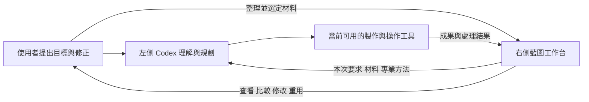

# 藍圖工作室專用工作台設計與開發指示

[左右協作流程](LEFT_RIGHT_WORKFLOW.md) · [運作分工](OPERATING_MODEL.md) · [開發指南](DEVELOPMENT.md) · [下一版工程候選](HARNESS_VALIDATION_NEXT.md)

**藍圖工作室的方向，是為 Codex 建立一個可長期使用、持續擴展的開源企業工作台。Codex 提供理解、規劃、工具操作與開發能力；藍圖提供公司的材料、工作情境、專業方法、操作介面及成果管理。服務由使用者指揮兩者協作而形成。**

本版先確立產品邏輯、介面形成方法及開發方向。新增自動檢查、測試與 AI 行為評估 Harness 留待下一版；現有開發規範繼續適用。以下區分已有基礎與建議方向，不把規劃中的工作模式當成已上線功能。

## 1 把開發資源放在企業工作環境

Codex 是由模型、對話、工具操作與執行流程組成的 AI 工作環境。藍圖選擇沿用這個持續演進的環境，把開發資源投入公司真正需要的工作方法和介面，減少重建通用 AI 對話與執行能力的成本。

這個選擇的價值在於分工。當 Codex 或其可用工具帶來新的能力，藍圖可以研究如何讓現有公司材料、工作要求和成果結構接上這些能力，形成新的服務。能力能否使用，仍取決於當前客戶端的支援、工具及授權；產品應把已可用的能力接好，再逐步擴展。

藍圖應長期累積的資產包括：整理好的公司材料、可重用的專業方法、與業務一致的工作物件、清楚的操作介面，以及能繼續修改和重用的成果。這些資產令下一次工作更容易開始，也讓公司逐步形成自己的工作方式。

「掛件」、「專用介面」、「工作台」或「專用 Harness」都可以描述這種產品關係。技術上，現行可以由 Codex 原有介面、並排的藍圖網站及已授權操作路徑配合；名稱本身不代表已取得 Codex 內嵌介面或官方插件身份。具體整合方式按客戶端實際能力決定。

## 2 左右協作本身就是服務的形成方式

左側讓使用者用自然語言交代目標、討論方向和修正要求。右側讓使用者整理材料、選定工作對象、查看進度、比較成果和保留公司的工作歷史。Codex 根據本次要求與材料，使用 Skill 和當前可用工具處理，再把結果交回同一個工作環境。

因此，右側每個畫面都應能回答：它幫助使用者把甚麼工作交給 Codex？Codex 需要從這裡取得甚麼？處理後，使用者在哪裡看到結果並繼續指揮？

右側亦承接工作跨對話的連續性。公司材料、要求、成品和待辦需要留在可重新讀取的位置。下次工作從保存的事實及使用者最新指示開始，讓歷次成果成為可選材料；對話內容則由使用者按需要整理成工作紀錄。

## 3 從 Zendesk 參考企業工作台的成熟做法

Zendesk 的參考價值在於它如何圍繞正在處理的工作，把上下文、狀態、知識、相關資料和操作安排在一起。官方 Agent Workspace 文件描述以 ticket 為中心的操作環境，context panel 則集中相關資訊與工作能力。這種安排有助使用者在處理一件事時，取得需要的材料和操作。[Agent Workspace](https://support.zendesk.com/hc/en-us/articles/4408821259930-About-the-Zendesk-Agent-Workspace)、[Context panel](https://support.zendesk.com/hc/en-us/articles/4408836526362-Using-the-context-panel)

藍圖可以借用這些設計原則，選擇適合自身服務的工作對象：一段影片、一個品牌企劃、一項客戶要求、一份研究或一個網站。每種對象都有自己的材料、限制、方法、成果和修改過程。

| 參考的設計原則 | 在藍圖中的運用 |
| --- | --- |
| 圍繞當前工作提供上下文 | 打開影片工作時，集中呈現本次素材、品牌要求、腳本、成品與修改意見 |
| 定義業務物件及彼此關係 | 先釐清素材屬於哪個項目、哪份要求產生哪個成果，再決定欄位和畫面 |
| 專業方法與知識來源分開 | Skill 保存做法；公司素材、品牌偏好及本次要求按工作選取 |
| 根據工作提供相關操作 | 使用者需要時才呈現本次工作適用的工具與操作，避免每頁塞入全部功能 |
| 保留人員判斷與後續處理 | 使用者可以比較成果、修訂要求、沿用合適內容，再交給 Codex 繼續 |

Zendesk 的 custom objects 文件顯示業務物件可以有欄位、權限和關係；auto assist 文件則分開配置使用條件、知識、procedures 與 actions。藍圖借鑑的是這種業務組織方法，再將自己的主要理解與執行流程放在 Codex。[Custom objects](https://support.zendesk.com/hc/en-us/articles/5914453843994-Understanding-custom-objects)、[Auto assist](https://support.zendesk.com/hc/en-us/articles/8013454025114-Turning-on-and-configuring-auto-assist)

這個取向不以客服作為藍圖的功能邊界，也不預設 Zendesk 的模型來源或完整能力範圍。藍圖的產品重心是讓 Codex 在同一個公司工作環境中，參與多種專業工作。參考來源與適用範圍見[研究筆記](https://github.com/collieai-g/Blueprint-Studio-Open-Source/blob/main/research/codex-workbench-reference.md)。

## 4 用影片工作說明完整服務

以「用已收集的圖片和影片，製作一段符合品牌風格的宣傳片」為主要設計例子。下表描述目標工作方式；目前材料、工作紀錄、Skill 交接和保存操作可作基礎，專用媒體檢視、逐版比較及剪輯整合仍須按現有能力逐項設計。

| 階段 | 右側藍圖提供的工作環境 | 左側 Codex 的工作 |
| --- | --- | --- |
| 收集 | 圖片、影片、產品資料、品牌參考及來源 | 按要求協助整理分類，辨認還缺哪些材料 |
| 指定 | 選定本次素材，寫明受眾、用途、片長、比例與風格 | 理解目標，釐清會影響製作的缺項 |
| 規劃 | 保留腳本、分鏡與素材引用 | 選擇合適方法，安排敘事、鏡頭順序、字幕與聲音 |
| 製作 | 提供授權素材及約定的交付位置 | 使用實際可用的剪輯、媒體處理或生成工具完成製作 |
| 檢視 | 呈現可開啟的真實成品，以及對應要求與素材 | 解釋取捨，根據使用者意見調整 |
| 重用 | 保存選定版本、品牌做法、可重用素材與下一步 | 為不同受眾、平台或下一次活動沿用合適內容 |

這裡的品質目標是：敘事符合用途、鏡頭和素材有清楚選擇、字幕及聲音適合品牌、交付格式可用，並能根據反饋修改。若某次對話只有規劃能力，先完成腳本和分鏡，再把尚缺的製作能力寫清楚；只有真實產生且可查看的媒體才呈現為成片。

公司的素材庫因此同時成為製作工作的起點。一次影片工作留下的腳本、方法與成品，經使用者選定後，又可以成為下次工作的材料。這種累積方式同樣適用於設計、研究、企劃和網站製作。

## 5 右側核心應提供哪些共用結構

介面先從工作需要形成。公司每種專業工作雖有不同內容，仍可共用六種結構：

| 共用結構 | 它解決的問題 |
| --- | --- |
| 材料 | 這次可以使用甚麼，內容在哪裡，來源是甚麼 |
| 要求 | 想完成甚麼，為誰而做，有哪些限制，交付到哪裡 |
| 方法與偏好 | 採用甚麼專業做法，哪些公司風格可以沿用 |
| 工作 | 現在處理哪項事情，已做到哪裡，仍需要甚麼 |
| 成果 | 真正產生了甚麼，對應哪份要求和材料，哪份是目前選定版本 |
| 反饋 | 使用者要改甚麼，哪些部分可保留，下次怎樣繼續 |

這是產品設計的共用語言，不要求立即建立六套新資料表。現有文件、收藏、項目、工作紀錄、報告、Skill 交接及 Agent 工作，應先檢查哪些已能承托這些需要。只有缺少的行為，才成為新功能。

工作介面應把上述關係放在同一脈絡：使用者選材料時看得到本次要求，查看成品時找得到來源和修改意見，交給 Codex 時知道交接範圍。使用者以業務語言操作；欄位、按鈕和後台規則則讓人與已授權 AI 都能準確完成同一項工作。

## 6 可以從共用底層發展的運行模式

下列是產品方向，按具體需要逐項選擇，不代表所有模式已提供。

| 模式 | 左右協作如何形成 | 可留下的公司資產 |
| --- | --- | --- |
| 材料整理 | 右側收集，Codex 協助分類、摘要和建立可用引用 | 可查找、可選用的公司材料 |
| 媒體製作 | 選定圖片影片與要求，Codex 組合專業方法和媒體工具 | 腳本、分鏡、成品及品牌做法 |
| 研究與企劃 | 選定問題和資料，Codex 分析、比較及提出方案 | 有來源的研究、決定及行動項目 |
| 客戶工作 | 將客戶要求連到產品資料、項目及工作，Codex 協助準備交付 | 回覆草稿、方案、報告及後續工作 |
| 網站與設計 | 整理品牌內容和設計要求，Codex 使用相應開發或製作工具 | 設計素材、內容、來源及可交付產物 |
| 工作台改善 | 使用者提出操作需要，Codex 協助調整已有設定或開發缺少的介面 | 更適合公司的操作方式及可維護的產品修改 |

新增模式時，優先重用材料、要求、工作及成果之間的關係。專業差異由 Skill、適當欄位與實際工具承接。只有需要新運算、渠道或持續運行能力時，才另行設計相應服務。

## 7 新介面應按三條路線形成

第一條是調整既有工作台：卡片位置、顯示文字、可見內容和參考資料。這類需求優先使用現有設定，讓使用者可以直接透過左側要求改善自己的工作環境。

第二條是組合新的專業工作：建立或調整 Skill、公司偏好、本次要求及材料選擇。需要固定設定和工作狀態時，可使用已有 Agent 工作規格；單純新增一種專業做法，不必先開發獨立 AI 服務。

第三條是開發尚未支持的產品能力：例如新的素材檢視方式、影片版本比較或原本沒有的業務操作。這時才進入介面、API 或適配器的來源開發，沿用專案既有的審閱與部署流程。AI 可以協助設計和實作；正式工作台保存的公司資料仍由其既有服務管理。

每個介面提案先寫清楚：

1. 使用者會在左側提出甚麼具體要求。
2. 右側要讓人收集、選擇、查看或修改甚麼工作物件。
3. Codex 需要收到哪些材料、條件和專業方法。
4. 它用甚麼已具備或待接入的工具處理。
5. 成果放回哪裡，使用者如何修改和再次使用。
6. 哪些部分可沿用現有功能，哪一部分才需要新開發。

保留既有四個主要入口及工作動線，將專業畫面放到適當位置。畫面改進要讓工作更容易理解和操作，並保留正在輸入的內容、材料選擇和工作進度。更詳細的既有規則見[版面](LAYOUT.md)與[左右協作流程](LEFT_RIGHT_WORKFLOW.md)。

## 8 跟隨 Codex 進步並保留擴展空間

第一優先是把與 Codex 配合的工作方式做好。當其能力更新時，先確認新能力在目前客戶端如何提供，再選一項可受益的公司工作，調整相關交接、專業方法或操作介面。公司材料與成果應保持穩定，不因更換一次工具而重新整理整個工作台。

後續相容其他主流 AI 時，沿用同一份公司資料、工作物件和成果關係，調整其實際支援的連接與操作方式。Skill 表達專業方法，工具提供執行能力，客戶端提供理解與協作流程；三者各自可以演進。

這種擴展並不假設不同 AI 能直接共享私人對話或接管正在執行的工作。現有接駁依[AI 接駁指南](AI_CONNECTION.md)及[Agent 規格](AGENT_CONTRACT.md)辦理；跨客戶端接管與新執行協定留作獨立的後續議題。

## 9 本版的開發次序

| 次序 | 應先完成的設計工作 | 具體交付 |
| --- | --- | --- |
| 1 確立定位 | 將藍圖定義為配合 Codex 的企業專用工作台，統一左右責任 | 本指示與開發入口，讓後續提案沿同一方向 |
| 2 畫清一項完整服務 | 以素材到影片成果為第一個主要例子，列出真正需要的步驟與能力 | 一份工作流程、資料關係及已有／待補功能清單 |
| 3 設計右側工作介面 | 對照收集、要求、製作、檢視及修改需要，沿用現有工作物件 | 介面提案、欄位、操作及成果去向 |
| 4 接好實際可用能力 | 選用當前 Codex 可用的媒體或檔案工具，補必要交接 | 一條可實際使用的工作路徑及清楚的能力範圍 |
| 5 抽取可重用做法 | 從實際工作留下可沿用的方法與偏好，再延伸下一種模式 | 專業 Skill、範本與適當的共用功能 |

這個次序先把一項服務形成，再把可重用部分帶到其他工作。開發者不需要預先建成所有部門、所有 AI 或完整模型供應商平台，便可以讓藍圖逐步產生實際用途。

## 10 給後續開發者與 Codex 的工作指示

> 請將藍圖工作室視為配合 Codex 使用的開源企業專用工作台。Codex 負責理解、規劃及運用當前工具；藍圖負責公司的材料、要求、專業方法、工作介面與成果。每個新功能都要說明它如何改善左右協作，讓一項公司工作更容易完成、修改和重用。
>
> 先理解具體業務，再設計工作物件、材料關係和介面。參考 Zendesk 等成熟企業軟件對上下文、狀態、知識及操作的組織方式，將適合的原則用在藍圖的媒體、設計、研究、項目及其他工作。以圖片與影片收集、交給 Codex 製作、回到藍圖檢視修改，作為主要設計例子。
>
> 提案必須交代左側指令、右側物件、所需材料、專業方法、實際工具、成果位置及修改方式。先沿用現有資料與操作，再選擇調整設定、組合 Skill 或開發新能力。現有功能與建議功能清楚標示；只有實際可用的工具才構成本次執行能力。
>
> 優先把 Codex 的使用體驗做好，保留未來相容其他 AI 的空間。隨能力進步調整相關工作路徑，持續累積公司的材料、做法與成果。本版先完成產品邏輯及開發方案，新增自動檢查、測試與 AI 行為評估 Harness 於下一版處理。

下一版的工程研究保留於[候選設計](HARNESS_VALIDATION_NEXT.md)。它不取代本版的產品優先次序；個別程式修改仍使用[現有開發流程](DEVELOPMENT.md)。
