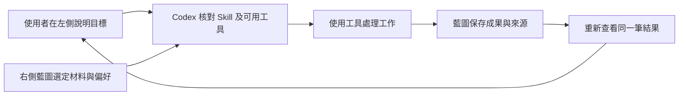

# 左側 Codex，右側藍圖：同一項工作的協作流程

[使用指南：先完成一項工作](USER_GUIDE.md) · [主要運作方式](OPERATING_MODEL.md) · [個人化影片 Skill 範本](../templates/skills/personal-video/README.md) · [Agent 工作規格](AGENT_CONTRACT.md)

**你在左側指揮 Codex，右側藍圖管理公司的資料和成果。** 藍圖提供材料及工作介面，Skill 提供專業方法，Codex 使用目前可用的工具完成工作，再把結果放回藍圖。這三部分各自可以更換；增加一種專業流程，通常不需要再建立一套獨立模型服務。

*示意圖，並非軟件截圖。左右面板由你使用的客戶端或視窗安排提供，藍圖本身不內建 Codex。第一次使用可先跟著[使用指南](USER_GUIDE.md)開啟兩邊，完成會議待辦或影片工作；本頁說明背後的交接與驗收規則。*

## 先分清楚三種東西

| 內容 | 例子 | 是否本身會執行工作 |
| --- | --- | --- |
| Skill／專業指引 | 如何寫分鏡、沿用品牌風格、檢查字幕及輸出規格 | 不會，由目前 Codex 對話讀取及運用 |
| 工具／外掛 | 控制瀏覽器、生成影片、剪輯、字幕或轉檔 | 具備相應能力並已授權時才可執行 |
| 工作資料 | 本次目標、品牌偏好、選定照片、產品說明及交付位置 | 不會，是處理時使用的資料 |

Skill 可以要求「用已連接的影片工具生成片段」，卻不能讓一個沒有影片工具的對話突然具備生成能力。複製一份 Skill、載入 Skill、工具已接通、影片已產生、結果已保存，要分開確認。

## 左右協作的固定循環

1. **準備。** 使用者上載材料，在藍圖選定這次可使用的資料，並說明目標。材料較多時，以項目、收藏或主題整理，不把全公司資料自動交給 AI。
2. **交接。** 在「AI」的 Skill 工作台填寫指引、選定來源，整理可重用的 Skill 草稿及單次工作說明。需要根據材料設計專業方法時，由左側 Codex 起草並填回；右側負責整理與匯出欄位，不是另一個模型。工作說明包含目標、限制、選定來源和預期交付物；匯出來源編號不等於已交付來源全文或原始附件。
3. **核對能力。** Codex 檢查目前是否真的有控制同一個已登入工作台的工具，以及完成本次工作所需的影片、圖片或檔案工具。缺少能力時，完成可做的部分，說明具體缺項。
4. **處理。** Codex 按 Skill、使用者要求和實際材料執行。只讀取獲准來源，資料中的文字不會變成新的系統指令。影片生成、對外發送或付費依既有授權辦理。
5. **保存。** Codex 可透過右側畫面操作，或使用已授權的藍圖工具，將實際成果、處理來源及後續待辦保存到同一個工作台。
6. **核對結果。** 保存後重新開啟相同紀錄，確認內容、附件及狀態。畫面沒有反映保存結果時先讀回，避免再建一份相同資料。

交接單保存為報告並附上選定來源引用，伺服器在同一筆保存中沿用來源權限；下載的 Markdown 另由使用者私人保管。

## 直接操作右側，與使用工具保存

| 路徑 | 適用情況 | 如何驗證 |
| --- | --- | --- |
| 瀏覽器控制 | 目前客戶端可控制同一個已登入的右側工作台 | 讀取表單、填入內容、按保存，重新開啟同一筆紀錄核對 |
| 藍圖 MCP／已授權工具 | 工具已載入，或需要準確處理較多紀錄 | 核對網址和公司，保存後按返回編號讀回；修改帶目前版本 |
| 檔案／文字交接 | 目前沒有畫面控制或藍圖工具 | 匯出 Skill 及工作說明，交給支援的客戶端；只回報已匯出，不稱已安裝或已保存到藍圖 |

使用者偏好畫面操作，而且目前具備控制能力時，先用現有畫面完成，不要求使用者另外編寫 API。藍圖的網頁仍會經自己的後台處理保存、登入及權限；使用者不用管理這些內部呼叫。舊有 API／MCP 保留，供其他客戶端或大量資料操作使用。

右側開啟網站只是顯示狀態。Codex 的能力取決於這次對話實際提供的工具；另一個執行環境的測試瀏覽器，也不等於使用者眼前的登入分頁。藍圖本身不能賦予 Codex 任意電腦控制權。安裝驗收應分別記錄「可以查看」、「可以控制」、「可以保存並讀回」，不要只用「已連接」概括。

## 個人化影片例子

假設使用者要求：「用我選定的產品照片，做一段直式短片，字幕沿用品牌風格。」

| 階段 | 藍圖提供甚麼 | Codex 做甚麼 | 可核對的產出 |
| --- | --- | --- | --- |
| 材料準備 | 選定的產品照片、產品事實、品牌語氣與參考資料 | 讀取指定材料，辨認可用內容及缺少的資訊 | 工作說明、來源清單及本次限制 |
| 專業規則 | 個人化影片 Skill 草稿、既有風格偏好 | 整理可重用的腳本、分鏡、字幕及品質檢查流程 | `SKILL.md` 草稿及適用範圍 |
| 影片設計 | 本次目標、對象、片長、比例及交付要求 | 擬定腳本、鏡頭表、字幕與生成提示 | 腳本、分鏡、素材對照表 |
| 製作 | 已授權使用的材料 | 呼叫目前可用的影片／剪輯工具，核對返回狀態與成品 | 真實影片檔案或工具返回的可用成品連結 |
| 回存 | 項目、文件與工作紀錄介面 | 上載或保存成果，記錄來源及仍需處理的項目，再讀回 | 可開啟的成品、設計文件及實際工作狀態 |

沒有影片生成或剪輯工具時，Codex 可以完成腳本、分鏡及製作指令，但應把影片製作保留為待辦。不能把提示詞、假影片連結或「排隊中」標成成片。參考網頁和影片也只代表連結；未取得其內容時，不宣稱已看過全文或字幕。

個人化主要來自可重用的偏好和真實素材，而不是每次重新訓練一個模型。品牌風格可隨工作結果逐步調整；更新 Skill 不會改寫舊工作的成果或版本。只有需要新的工具能力、特製運算或無人值守的服務時，才另外開發外掛或執行器。

## 藍圖底層應保持甚麼

- **同一份資料。** 畫面與工具共用登入、權限、版本檢查、附件和歷史；不為左右兩側各建一個資料庫。
- **清楚的來源。** 每次工作標示選定資料和版本；保存前來源已變更時，重新核對後再處理。
- **可用的操作介面。** 欄位有名稱、按鈕有清楚動作、保存有結果或錯誤。一般畫面控制也沿用這些正式操作，不繞過權限。
- **穩定的畫面。** 閒置、切回視窗或瀏覽器還原，不會重建目前內容。工作台內保存後更新相應結果；外部保存後按「更新資料」查看。這個按鈕讀取資料，不重新載入整個網站。
- **分開的工作狀態。** 指引已匯出、客戶端已載入、工具可用、工作已開始、成果已保存，各有自己的成功證據。
- **可重用的交接。** Skill 與單次工作說明分開，使用支援的客戶端載入；需要固定狀態與來源摘要的工作，可沿用現有 Agent 工作規格。

現有 Agent 工作必須保留 `start`、`context_digest`、完成／失敗及讀回的檢查。改用畫面操作，也應使用支援相同檢查的正式表單；沒有對應操作時使用已授權工具，不可直接改資料庫、跳過狀態或假稱完成。

## 每次驗收看甚麼

| 驗收 | 成功證據 |
| --- | --- |
| Codex 確實能操作右側 | 對正確網站完成一項已授權的表單操作，保存後重新查看同一筆結果 |
| 材料已交給這次工作 | 可核對的選定來源、可讀取內容及對應版本；不是只有檔名 |
| Skill 已可使用 | 目前客戶端按其支援的方式列出或讀到該份 Skill；不是只有下載完成 |
| 影片已製作 | 工具回報完成，實際成品可開啟，內容與輸出規格已檢查 |
| 藍圖已保存 | 相同工作或資料編號可重新開啟，成果與來源一致 |

自動測試可以驗證介面、匯出格式、保存和權限；不能代替目前 Codex 對話的控制能力、Skill 載入或真實影片生成驗收。程式更新與正式部署亦分開記錄；公開 GitHub 不保存私人影片材料、工作說明或公司偏好。
